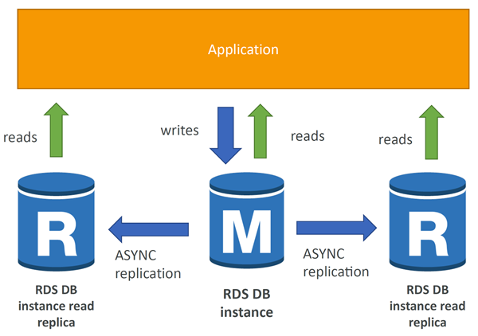
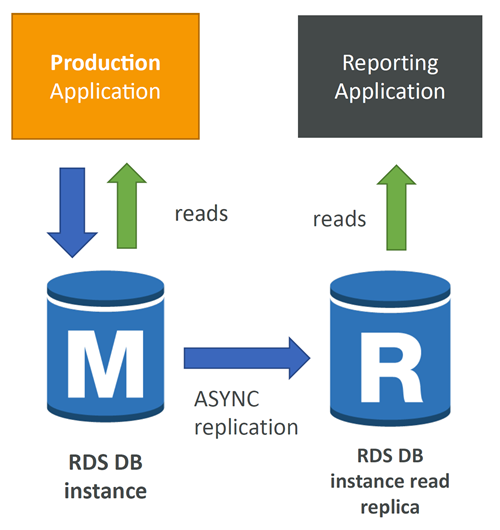
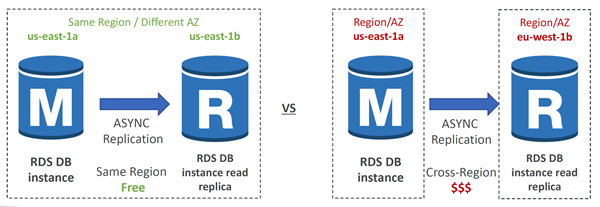
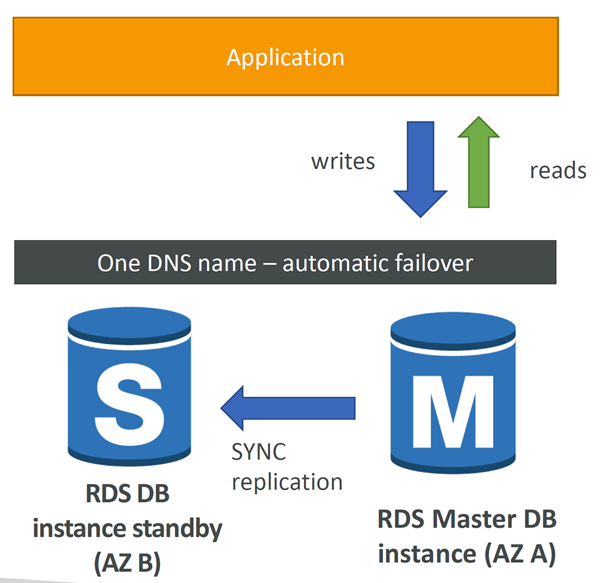
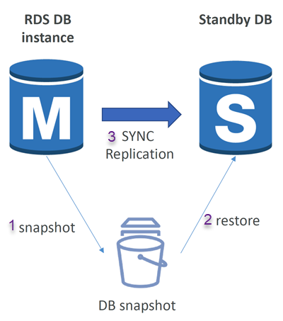
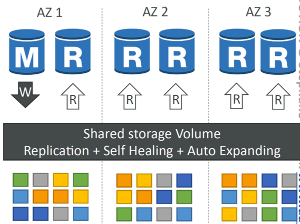
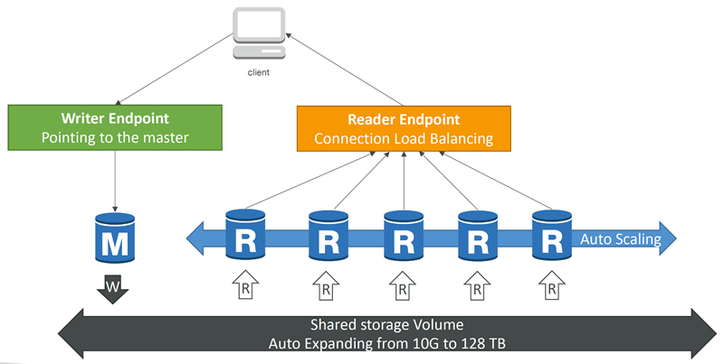

# Amazon RDS

## Amazon RDS Overview
* RDS stands for `Relational Database Service`
* It’s a managed DB service for DB that <u>use SQL as a query language</u>.
* It allows you to create databases in the cloud that are managed by AWS
  * Postgres
  * MySQL
  * MariaDB
  * Oracle
  * Microsoft SQL Server
  * IBM DB2
  * Aurora (AWS Proprietary database)

## Advantage over using RDS versus deploying DB on EC2
* RDS is a managed service:
  * Automated provisioning, OS patching
  * Continuous backups and restore to specific timestamp (Point in Time Restore)!
  * Monitoring dashboards
  * Read replicas for improved read performance
  * Multi AZ setup for DR (Disaster Recovery)
  * Maintenance windows for upgrades
  * Scaling capability (vertical and horizontal)
  * Storage backed by EBS
* BUT you can’t SSH into your instances

## RDS – Storage Auto Scaling
* Helps you increase storage on your RDS DB instance dynamically
* When RDS detects you are running out of free database storage, it scales automatically
* Avoid manually scaling your database storage
* You have to set `Maximum Storage Threshold` (maximum limit for DB storage)
* Automatically modify storage if:
  * Free storage is `less than 10%` of allocated storage
  * `Low-storage lasts at least 5 minutes`
  * `6 hours have passed` since last modification
* Useful for applications with `unpredictable workloads`
* Supports all RDS database engines

## RDS Read Replicas for read scalability
* Up to 15 Read Replicas
* Within:
  * `Same AZ`, 
  * `Cross AZ` or 
  * `Cross Region`
* Replication is **ASYNC**, so reads are eventually consistent
* Replicas can be promoted to their own DB
* Applications must update the connection string to leverage read replicas



### RDS Read Replicas – Use Cases
* You have a production database that is taking on normal load
* You want to run a reporting application to run some analytics
* You create a Read Replica to run the new workload there
* The production application is unaffected
* Read replicas are used for SELECT (=read) only kind of statements (not INSERT, UPDATE, DELETE)



## RDS Read Replicas – Network Cost
* In AWS there’s a `network cost` when data goes `from one AZ to another`
* For RDS Read Replicas within the `same region / different AZ` = Free, you don’t pay that fee




## RDS Multi AZ (Disaster Recovery)
* SYNC replication
* One DNS name – automatic app failover to standby
* Increase availability
* Failover in case of loss of AZ, loss of network, instance or storage failure
* No manual intervention in apps
* Not used for scaling
* Note: The Read Replicas be setup as Multi AZ for Disaster Recovery (DR)



## RDS – From Single-AZ to Multi-AZ
* Zero downtime operation (no need to stop the DB)
* Just click on “modify” for the database
* The following happens internally:
  * A snapshot is taken
  * A new DB is restored from the snapshot in a new AZ
  * Synchronization is established between the two databases



NOTE: For the exercise download
```
sql electron
```


---


# Amazon Aurora

## Amazon Aurora
* Aurora is a proprietary technology from AWS (not open sourced)
* Postgres and MySQL are both supported as Aurora DB (that means your drivers will work as if Aurora was a Postgres or MySQL database)
* Aurora is “AWS cloud optimized” and claims 5x performance improvement over MySQL on RDS, over 3x the performance of Postgres on RDS
* Aurora storage automatically grows in increments of 10GB, up to 256 TB.
* Aurora can have up to 15 replicas and the replication process is faster than MySQL (sub 10 ms replica lag)
* Failover in Aurora is instantaneous. It’s HA (High Availability) native.
* Aurora costs more than RDS (20% more) – but is more efficient

## Aurora High Availability and Read Scaling
* 6 copies of your data across 3 AZ:
  * 4 copies out of 6 needed for writes
  * 3 copies out of 6 need for reads
  * Self healing with peer-to-peer replication
  * Storage is striped across 100s of volumes
* One Aurora Instance takes writes (master)
* Automated failover for master in less than 30 seconds
* Master + up to 15 Aurora Read Replicas serve reads
* Support for Cross Region Replication




Reader endpoint load balancing happens at the connection level, not the statement level 




## Features of Aurora
* Automatic fail-over
* Backup and Recovery
* Isolation and security
* Industry compliance
* Push-button scaling
* Automated Patching with Zero Downtime
* Advanced Monitoring
* Routine Maintenance
* Backtrack: restore data at any point of time without using backups

