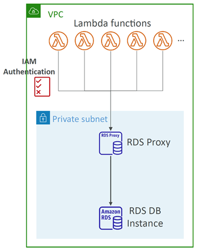
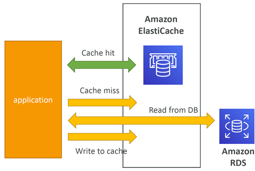
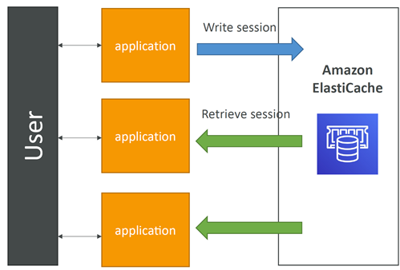
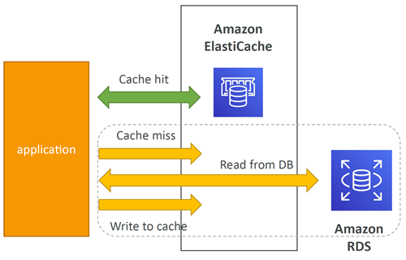
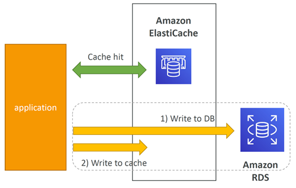
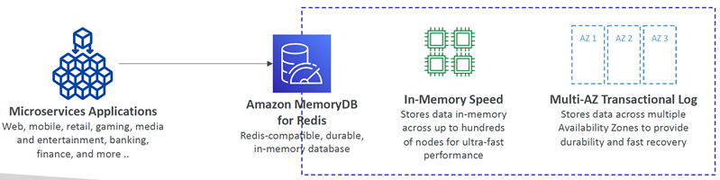

# Amazon RDS

## Amazon RDS Overview
* RDS stands for `Relational Database Service`
* It’s a managed DB service for DB that <u>use SQL as a query language</u>.
* It allows you to create databases in the cloud that are managed by AWS
  * Postgres
  * MySQL
  * MariaDB
  * Oracle
  * Microsoft SQL Server
  * IBM DB2
  * Aurora (AWS Proprietary database)

## Advantage over using RDS versus deploying DB on EC2
* RDS is a managed service:
  * Automated provisioning, OS patching
  * Continuous backups and restore to specific timestamp (Point in Time Restore)!
  * Monitoring dashboards
  * Read replicas for improved read performance
  * Multi AZ setup for DR (Disaster Recovery)
  * Maintenance windows for upgrades
  * Scaling capability (vertical and horizontal)
  * Storage backed by EBS
* BUT you can’t SSH into your instances

## RDS – Storage Auto Scaling
* Helps you increase storage on your RDS DB instance dynamically
* When RDS detects you are running out of free database storage, it scales automatically
* Avoid manually scaling your database storage
* You have to set `Maximum Storage Threshold` (maximum limit for DB storage)
* Automatically modify storage if:
  * Free storage is `less than 10%` of allocated storage
  * `Low-storage lasts at least 5 minutes`
  * `6 hours have passed` since last modification
* Useful for applications with `unpredictable workloads`
* Supports all RDS database engines

## RDS Read Replicas for read scalability
* Up to 15 Read Replicas
* Within:
  * `Same AZ`, 
  * `Cross AZ` or 
  * `Cross Region`
* Replication is **ASYNC**, so reads are eventually consistent
* Replicas can be promoted to their own DB
* Applications must update the connection string to leverage read replicas


### RDS Read Replicas – Use Cases
* You have a production database that is taking on normal load
* You want to run a reporting application to run some analytics
* You create a Read Replica to run the new workload there
* The production application is unaffected
* Read replicas are used for SELECT (=read) only kind of statements (not INSERT, UPDATE, DELETE)


## RDS Read Replicas – Network Cost
* In AWS there’s a `network cost` when data goes `from one AZ to another`
* For RDS Read Replicas within the `same region / different AZ` = Free, you don’t pay that fee


## RDS Multi AZ (Disaster Recovery)
* SYNC replication
* One DNS name – automatic app failover to standby
* Increase availability
* Failover in case of loss of AZ, loss of network, instance or storage failure
* No manual intervention in apps
* Not used for scaling
* Note: The Read Replicas be setup as Multi AZ for Disaster Recovery (DR)


## RDS – From Single-AZ to Multi-AZ
* Zero downtime operation (no need to stop the DB)
* Just click on “modify” for the database
* The following happens internally:
  * A snapshot is taken
  * A new DB is restored from the snapshot in a new AZ
  * Synchronization is established between the two databases


NOTE: For the exercise download
```
sql electron
```


---


# Amazon Aurora

## Amazon Aurora
* Aurora is a proprietary technology from AWS (not open sourced)
* Postgres and MySQL are both supported as Aurora DB (that means your drivers will work as if Aurora was a Postgres or MySQL database)
* Aurora is “AWS cloud optimized” and claims 5x performance improvement over MySQL on RDS, over 3x the performance of Postgres on RDS
* Aurora storage automatically grows in increments of 10GB, up to 256 TB.
* Aurora can have up to 15 replicas and the replication process is faster than MySQL (sub 10 ms replica lag)
* Failover in Aurora is instantaneous. It’s HA (High Availability) native.
* Aurora costs more than RDS (20% more) – but is more efficient

## Aurora High Availability and Read Scaling
* 6 copies of your data across 3 AZ:
  * 4 copies out of 6 needed for writes
  * 3 copies out of 6 need for reads
  * Self healing with peer-to-peer replication
  * Storage is striped across 100s of volumes
* One Aurora Instance takes writes (master)
* Automated failover for master in less than 30 seconds
* Master + up to 15 Aurora Read Replicas serve reads
* Support for Cross Region Replication


Reader endpoint load balancing happens at the connection level, not the statement level 


## Features of Aurora
* Automatic fail-over
* Backup and Recovery
* Isolation and security
* Industry compliance
* Push-button scaling
* Automated Patching with Zero Downtime
* Advanced Monitoring
* Routine Maintenance
* Backtrack: restore data at any point of time without using backups


## RDS & Aurora Security
* `At-rest encryption`:
  * Database master & replicas encryption using AWS KMS – must be defined as launch time
  * If the master is not encrypted, the read replicas cannot be encrypted
  * To encrypt an un-encrypted database, go through a DB snapshot & restore as encrypted
* `In-flight encryption`: TLS-ready by default, use the AWS TLS root certificates client-side
* `IAM Authentication`: IAM roles to connect to your database (instead of username/pw)
* `Security Groups`: Control Network access to your RDS / Aurora DB
* `No SSH available` except on RDS Custom
* `Audit Logs can be enabled` and sent to CloudWatch Logs for longer retention

## Amazon RDS Proxy
* Fully managed database proxy for RDS
* Allows apps to pool and share DB connections established with the database
* `Improving database efficiency by reducing the stress` on database resources (e.g., CPU, RAM) and `minimize open connections` (and timeouts)
* `Serverless, autoscaling, highly available (multi-AZ)`
* Reduced RDS & Aurora `failover time by up 66%`
* Supports RDS (MySQL, PostgreSQL, MariaDB, MS SQL Server) and Aurora (MySQL, PostgreSQL)
* No code changes required for most apps
* Enforce IAM Authentication for DB, and securely store credentials in AWS Secrets Manager
* RDS Proxy is` never publicly accessible (must be accessed from VPC)`




---


# Amazon ElastiCache

## Amazon ElastiCache Overview
* The same way RDS is to get managed Relational Databases…
* ElastiCache is to get managed Redis or Memcached
* Caches are in-memory databases with really high performance, low latency
* Helps reduce load off of databases for read intensive workloads
* Helps make your application stateless
* AWS takes care of OS maintenance / patching, optimizations, setup, configuration, monitoring, failure recovery and backups
* <u>Using ElastiCache involves heavy application code changes</u>

### ElastiCache Solution Architecture - DB Cache
* Applications queries ElastiCache, if not available, get from RDS and store in ElastiCache.
* Helps relieve load in RDS
* Cache must have an invalidation strategy to make sure only the most current data is used in there.



### ElastiCache Solution Architecture – User Session Store
* User logs into any of the application
* The application writes the session data into ElastiCache
* The user hits another instance of our application
* The instance retrieves the data and the user is already logged in




## ElastiCache – Redis vs Memcached 

REDIS  R --> (replication) R
-----
* Multi AZ with Auto-Failover
* Read Replicas to scale reads and have high availability
* Data Durability using AOF persistence
* Backup and restore features
* Supports Sets and Sorted Sets

MEMCACHED   M + (sharding) M
---------
* Multi-node for partitioning of data (sharding)
* No high availability (replication)
* Non persistent
* Backup and restore (Serverless)
* Multi-threaded architecture

## ElastiCache Strategies

### Caching Implementation Considerations
* Read more at: https://aws.amazon.com/caching/implementationconsiderations/
* Is it safe to cache data? 
  * Data may be out of date, eventually consistent
* Is caching effective for that data?
  * Pattern: data changing slowly, few keys are frequently needed
  * Anti patterns: data changing rapidly, all large key space frequently needed
* Is data structured well for caching?
  * example: key value caching, or caching of aggregations results
* Which caching design pattern is the most appropriate?
  * Lazy Loading / Cache-Aside / Lazy Population

#### Lazy Loading / Cache-Aside / Lazy Population
Pros
------
* Only requested data is cached (the cache isn’t filled up with unused data)
* Node failures are not fatal (just increased `latency to warm the cache`)

Cons
------
* Cache miss penalty that results in 3 round trips, noticeable delay for that request:
  * cache miss
  * read from DB
  * write to cache
* Stale data: data can be updated in the database and outdated in the cache



``` Python
# Python pseudocode
def get_user(user_id):
    # Check the chache
    record = cache.get(user_id)

    if record is None:
        # Run a DB query
        record = db.query("select * from users where id = ?", user_id)
        #Populate the cache
        cache.set(user_id, record)
        return record
    else:
        return record
# App code
user = get_user(17)
```

#### Write Through – Add or Update cache when database is updated
Pros
------
* Data in cache is never stale, `reads are quick`
* Write penalty vs `Read penalty` (each write `requires 2 calls`):
  * Write to DB
  * Write to cache

Cons
------
* Missing Data until it is added / updated in the DB. Mitigation is to implement Lazy Loading strategy as well
* Cache churn – a lot of the data will never be read



``` Python
# Python pseudocode
def save_user(user_id, values):
    # Save to DB
    record = db.query("update users... where id = ?", user_id, values)
    # push into cache
    cache.set(user_id, record)
    return record

# App code
user = save_user(17, {"name": "Nate Dogg"})
```

#### Cache Evictions and Time-to-live (TTL)
* Cache eviction can occur in three ways:
  * You delete the item explicitly in the cache
  * Item is evicted because the memory is full and it’s not recently used (LRU - least recently used)
  * You set an item `time-to-live (or TTL)`
* TTL are helpful for any kind of data:
  * Leaderboards
  * Comments
  * Activity streams
* TTL can range from few seconds to hours or days
* If too many evictions happen due to memory, you should scale up or out

### Final words of wisdom
* Lazy Loading / Cache aside is easy to implement and works for many situations as a foundation, especially on the read side
* Write-through is usually combined with Lazy Loading as targeted for the queries or workloads that benefit from this optimization
* Setting a TTL is usually not a bad idea, except when you’re using Writethrough. Set it to a sensible value for your application
* Only cache the data that makes sense (user profiles, blogs, etc…)
* Quote: There are only two hard things in Computer Science: cache invalidation and naming things


---


# Amazon MemoryDB for Redis
* Redis-compatible, durable, in-memory database service
* Ultra-fast performance with over 160 millions requests/second
* Durable in-memory data storage with Multi-AZ transactional log
* Scale seamlessly from 10s GBs to 100s TBs of storage
* Use cases: web and mobile apps, online gaming, media streaming, …



