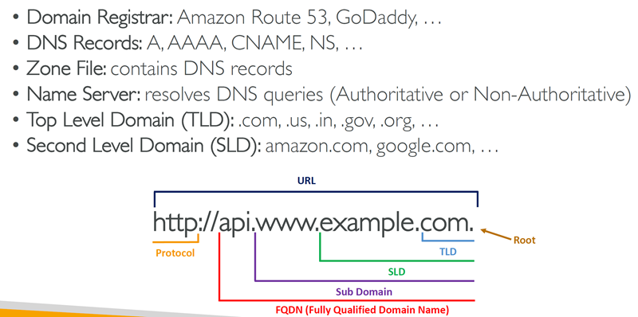
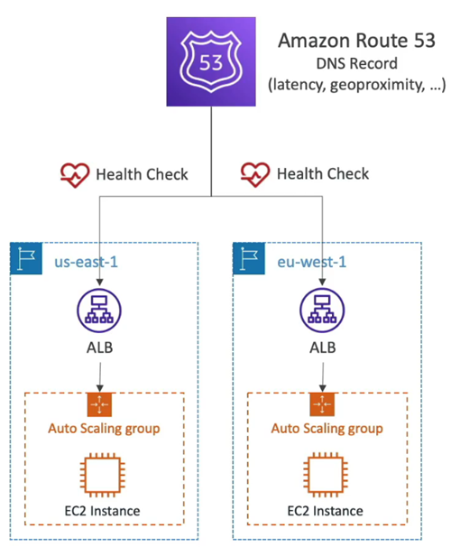
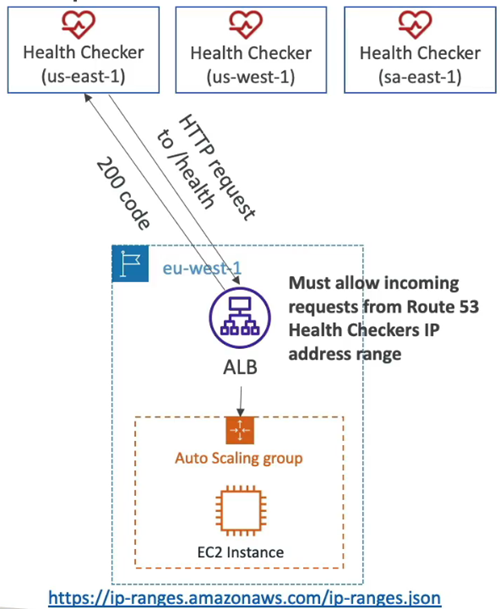
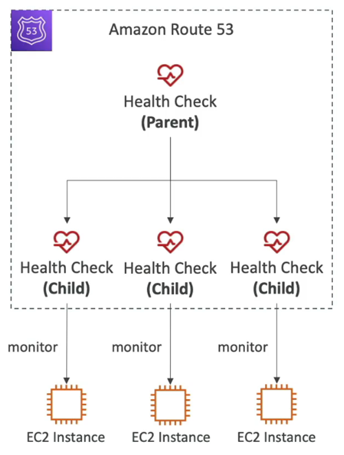
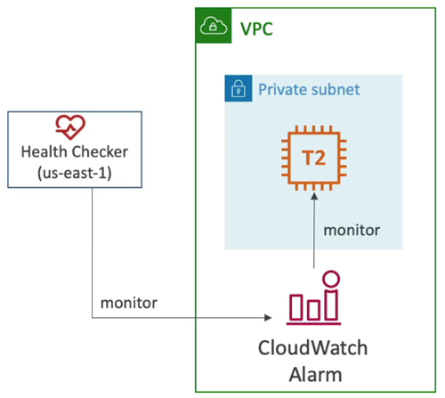

# Amazon Route 53

## At a glance
- Route 53 is AWS's `authoritative DNS` service, with hosted zones, health checks, and routing policies.
- Route 53 is A highly available, scalable, fully managed and Authoritative DNS 
  - `Authoritative` means the domain owner controls the records; it does not mean Route 53 forwards application traffic.
- Hosted zones can answer public queries or resolve names privately from associated VPCs.
- TTLs and routing policies affect DNS answers and caching; they do not route application packets.
- Health checks can influence supported routing records, but checks and DNS caching add failover delay.
- Nice to know:
  - The only AWS service which provides `100% availability` SLA
  - Why Route 53? 53 is a reference to the traditional `DNS port`

## DNS and hosted zones
- The **Domain Name System (DNS)** maps human-readable names to values clients can use to connect, commonly IPv4 or IPv6 addresses.
  - It is hierarchical: root servers delegate to top-level domains (such as `.com`), which lead to authoritative servers for a registered domain and its subdomains.
- A **domain registrar** handles domain registration; 
- a **DNS provider** hosts the records that answer queries. These can be different providers.
  - To move DNS hosting to Route 53 while keeping a third-party registrar, create a public hosted zone and update the registrar's name-server (`NS`) delegation to the Route 53 name servers.

- A **Hosted zone** is a container for records for a domain and its subdomains:
  - **Public hosted zones** answer public DNS queries for internet-facing names.
  - **Private hosted zones** resolve names only from associated VPCs. They are useful for internal service names and can be associated with multiple VPCs, subject to account/Region association setup.
- A DNS record includes a 
  * `Domain/subdomain Name` – e.g., example.com
  * `Record Type` – e.g., A or AAAA
  * `Value or Target` – e.g., 12.34.56.78
  * `Routing Policy` – how Route 53 responds to queries
  * `TTL` – amount of time the record cached at DNS Resolvers
- Common types: 
  - `A` (IPv4), 
  - `AAAA` (IPv6), 
  - `CNAME` (another DNS name), 
    - The target is a domain name which `must have an A or AAAA` record
    - Can’t create a CNAME record for the top node of a DNS namespace (Zone Apex) ie. you can’t create for `example.com`, but you can create for `www.example.com`
  - `NS` (name servers).
- Other supported types include 
  - `MX`, `TXT`, `CAA`, `PTR`, and `SRV`.

## TTLs and alias records
- A **time-to-live (TTL)** tells recursive resolvers how long they may cache a DNS answer.
  - A long TTL reduces repeat queries but keeps old answers cached longer after a change.
  - A short TTL makes changes take effect sooner at the cost of more queries.
  - Cached answers can persist until their TTL expires, so DNS changes are not necessarily instantaneous.
- A `CNAME` maps a non-apex name, such as `www.example.com`, to another hostname.
  - DNS standards do not allow a CNAME at a zone apex (`example.com`) because the apex must also contain records such as `NS` and SOA.
  - Only for `NON root domain`
- A Route 53 **Alias** record is AWS's extension for pointing a name at supported AWS resources or another record in the same hosted zone.
  - Works for `Root Domain and NON Root Domain`
  - It uses `A` and/or `AAAA`, works at the zone apex, and tracks changes to the target resource's addresses.
  - Supported targets include Elastic Load Balancing, CloudFront, API Gateway, Elastic Beanstalk, S3 static website endpoints, Global Accelerator, and certain VPC endpoints.
  - A regular EC2 instance DNS name is not an Alias target.
- Alias records do not have a user-configurable TTL; the target's TTL behavior is used. 
  - For supported AWS-resource aliases, Route 53 does not charge for the alias query itself; this does not make all Route 53 features or queries free.
  - Alias Records Targets:
    * Elastic Load Balancers
    * CloudFront Distributions
    * API Gateway
    * Elastic Beanstalk environments
    * S3 Websites
    * VPC Interface Endpoints
    * Global Accelerator accelerator
    * Route 53 record in the same hosted zone
    * You cannot set an ALIAS record for an EC2 DNS name

## Routing policies
- Routing policies determine which DNS answer Route 53 returns. They influence where a client connects after DNS resolution; they are not application load balancers and do not route packets.
- **Simple:** 
  - Returns `one record or multiple` values in the answer.
  - `With multiple values the client chooses`; this is not health-aware load balancing.
  - Simple routing does not use health checks, and an Alias configuration targets a single AWS resource.
- **Weighted:** 
  - Assigns `relative weights to same-name`, same-type records and distributes DNS responses proportionally.
  - Weights no need to sum 100.
  - `A zero-weight record receives no traffic` when other records have nonzero weights; `if all weights are zero, they are treated equally`.
  - Useful for canaries, gradual migration, or splitting traffic among Regions.
  - DNS caching means observed client traffic may not exactly match the configured percentages. Health checks can be associated with records.
- **Latency-based:** 
  - `Returns the endpoint` associated with the AWS Region `expected to have the lowest latency from the querying user`.
  - Latency is based on traffic between users and AWS Regions
  - `Useful for multi-Region` applications where responsiveness matters; geography does not dictate the answer.
  - Cab assicuate `with Health checks` can exclude unhealthy endpoints.
- **Failover:** 
  - Active-passive routing returns the primary while its health check is healthy and the secondary when it is unhealthy. 
  - Use it for disaster recovery, with a secondary endpoint ready to serve traffic.
- **Geolocation:** 
  - Selects a `record using the location` of the DNS query (`continent, country, or US state`).
  - Useful for localization, compliance-based content delivery, or regional experiences.
  - Add a default record for queries that do not match a configured location.
- **Geoproximity:** 
  - Routes `based on the relative locations` of users and resources.
  - Ability to shift more traffic to resources based on the `defined bias`
  - A bias from `-99` to `+99` shrinks or expands a resource's effective geographic area.
    * To expand (1 to 99) – more traffic to the resource
    * To shrink (-1 to -99) – less traffic to the resource
  - AWS resources use their Region; non-AWS resources use latitude and longitude.
  - This policy requires Route 53 Traffic Flow.
- **IP-based:** 
  - `Maps caller CIDR ranges` (organized into CIDR collections) to designated endpoints. It can optimize for known network populations, such as sending a particular ISP's users to a nearer service.
  - Use cases: Optimize performance, reduce network costs…
- **Multi-value answer:** 
  - Can return `up to 8 healthy records` for a query.
  - It offers health-aware DNS answers, but it is not a substitute for a load balancer and does not guarantee that clients select a particular result.

## Health checks
- HTTP `Health Checks are only for public` resources
- Health checks can monitor:
  - public `endpoints`, 
  - combine other checks (`Calculated` Health Checks) 
  - `evaluate CloudWatch` alarms.

- **Endpoint** Health checks
  - Endpoint checks support HTTP, HTTPS, and TCP.
  - About 15 global health checkers will check the endpoint health and Unhealthy threshold = 3, interval = 30s (or 10s)
  - If `> 18%` of health checkers `report the endpoint is healthy`, Route 53 considers it `Healthy`. Otherwise, it’s Unhealthy
  - HTTP checks can validate a response code and optionally search response text (in the first 5120 bytes)
  - Configure firewalls to

- **Calculated** health checks
  - combine up to 255 child checks 
  - with AND, OR, or NOT logic and can define how many children must pass.

- **CloudWatch alarm** health checks
  - Public health-checking systems `cannot directly reach endpoints inside a private VPC`.
  - For private-resource health, publish an appropriate metric and alarm in CloudWatch, then have a Route 53 health check evaluate that alarm.
  - Health status can be associated with supported routing records to stop returning unhealthy destinations.

  

## Domain Registar vs. DNS Service
* You buy or register your domain name with a Domain Registrar typically by paying annual charges (e.g., GoDaddy, Amazon Registrar Inc., …)
* The Domain Registrar usually provides you with a DNS service to manage your DNS records
* But you can use another DNS service to manage your DNS records
* Example: purchase the domain from GoDaddy and use Route 53 to manage your DNS records

## Caveats and exam gotchas
- Health checks and DNS caching introduce detection and failover delay; they are not instantaneous application-level failover.
- Historic slide examples include specific hosted-zone prices, health-check intervals, and DNS availability claims. Pricing and service terms change, so consult current Route 53 documentation for exact values rather than relying on fixed course-era numbers.
