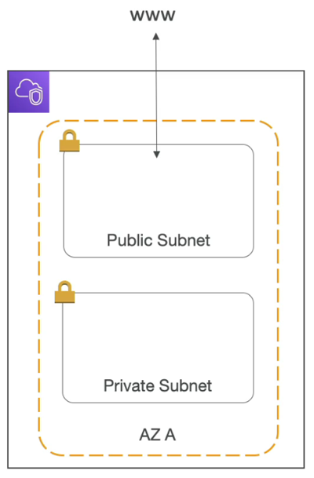
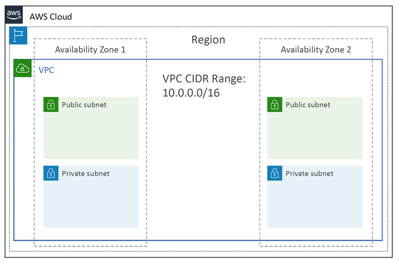
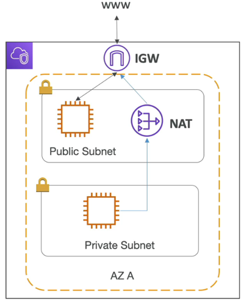
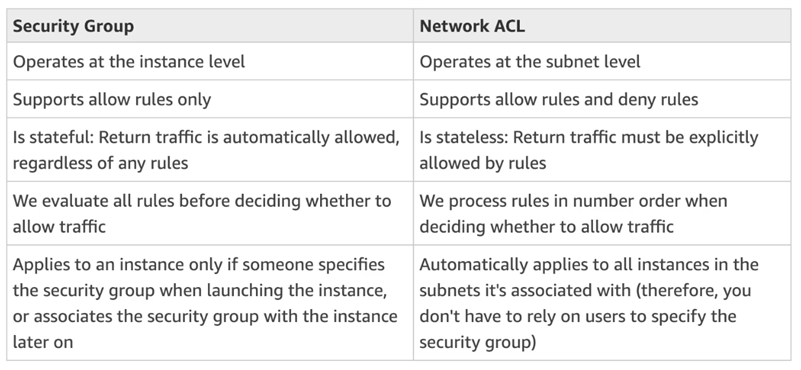
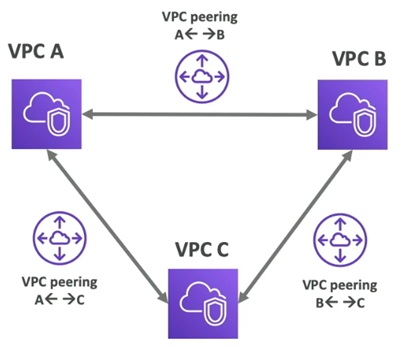
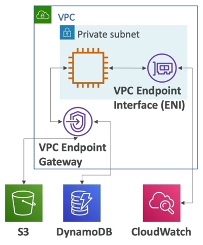
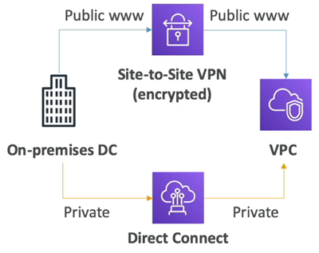

# Amazon VPC – Basics

## At a glance
- A VPC is a regional network; each subnet belongs to one Availability Zone.
- Route tables, gateways, and endpoints determine connectivity; “public” and “private” describe routing.
- Security groups are stateful; network ACLs are stateless and apply at subnet boundaries.
- Peering, VPN, and Direct Connect provide different private-connectivity paths.

## VPCs, subnets, and routes
- A **Virtual Private Cloud (VPC)** is a logically isolated network in one AWS Region.
  - It has IPv4 and optionally IPv6 address ranges (CIDRs) from which subnet ranges are allocated.
  - Plan non-overlapping ranges if the network may later connect to other VPCs or on-premises networks.
- A **subnet** is a `range of addresses inside a VPC` and belongs to exactly one Availability Zone.
  - A VPC can span AZs, so resilient architectures commonly use subnets in multiple AZs.
  - `“Public”` and `“private”` describe routing, not a subnet checkbox or an instance's role.
  - A subnet is generally `public` when its route table` has a route to an Internet Gateway` (IGW).
  - An instance also needs a public IPv4 address or Elastic IP (or suitable IPv6 configuration) and permissive network controls to be reachable from the internet.
  - A `private` subnet `has no direct internet route`.
- **Route tables** determine `where subnet traffic is sent`.
  - Each subnet is associated with one route table (explicitly or through the main table).
  - Local VPC traffic is routed within the VPC by default.

## Internet and outbound connectivity
- An `Internet Gateway` **IGW** 
  - attaches to a VPC and provides internet routing for eligible resources.
  - A public subnet's route table normally includes `0.0.0.0/0` to the IGW (and `::/0` for IPv6, if used).
  - An IGW alone does not give a private instance public reachability.
- A **NAT Gateway** 
  - managed by AWS
  - `allows instances in private subnets to initiate connections` to the internet or other public destinations while preventing unsolicited internet-initiated connections back through that NAT path.
  - For internet access, place the NAT Gateway in a public subnet, associate an Elastic IP, and route private-subnet default traffic to it.
  - The NAT Gateway itself needs a route to the IGW.
- NAT Gateways are managed and typically deployed per AZ for availability and to avoid cross-AZ traffic.
  - They incur hourly and data-processing charges; use VPC endpoints for supported AWS services where that is preferable.
  - A self-managed NAT instance is an alternative but requires patching, scaling, and availability management.

## Security groups, network ACLs, and flow logs
- A **network ACL (NACL)** 
  - NACL = a stateless `firewall` applied `at the subnet boundary/level`.
  - Can have `ALLOW` and `DENY` rules over IP ranges and protocols/ports.
  - Inbound and outbound rules are evaluated separately; allow return traffic and ephemeral ports explicitly.
  - The **default NACL** `commonly allows all traffic`, while a newly created **custom NACL** `denies traffic` until rules are added.
  
- A **security group** 
  - is a stateful `virtual firewall` associated with an Elastic Network Interface `(ENI)`, commonly `through an EC2` instance.
  - It has `ONLY ALLOW` rules. Return traffic for an allowed connection is automatically permitted.
  - Rules can identify IP/CIDR ranges, protocol/port ranges, or another security group, which is useful for tier-to-tier access without hard-coding instance addresses.
- Both layers apply: 
  - a packet must pass the NACL and the relevant security-group rules.
  - Security groups are usually the primary instance-level control; NACLs can provide a coarse subnet boundary or explicit deny.
  
- **VPC Flow Logs** 
  - `capture metadata about IP traffic` going into your interfaces:
    - for a VPC, 
    - for subnet,
    - for ENI.
  - They help `diagnose accepted and rejected network flows`, but are not packet captures and `do not show payloads`.
  - Logs can be sent to CloudWatch Logs, S3, or Kinesis Data Firehose.

## Private connectivity
- **VPC peering** 
  - `privately connects two VPCs`.
  - Their `CIDR ranges must not overlap`, routes must be configured on both sides, and security controls must allow the traffic.
  - Peering is `not transitive`: if A peers with B and B peers with C, A cannot reach C through B unless it has its own connectivity path.

- **VPC endpoints** 
  - let VPC resources `reach supported AWS services without` traversing the `public internet`:
  - gives you enhanced security and lower latency to access AWS services
  - **Gateway endpoints** 
    - only support S3 and DynamoDB and are selected in route tables. 
    - They do not use endpoint ENIs and are generally available without hourly endpoint charges.
  - **Interface endpoints** 
    - use AWS PrivateLink and create private ENIs in selected subnets. 
    - They support many AWS services and some endpoint services (including S3 and DynamoDB); 
    - security groups, DNS, and endpoint policies may need configuration. They are billed according to current endpoint pricing.

- **Site-to-Site VPN** 
  - connects an `on-premises network to a VPC` using `encrypted tunnels` `over the public internet`.
  - It can be faster to establish than a dedicated circuit but depends on internet connectivity.
- **Direct Connect** 
  - establishes a `dedicated network connection from a customer location to AWS`.
  - It offers predictable `private connectivity`, but is not inherently encrypted; use additional encryption such as a VPN when required.
  - `Provisioning can take time` and a single connection is not automatically resilient.

## VPC Closing Comments
* `VPC`: Virtual Private Cloud
* `Subnets`: Tied to an AZ, network partition of the VPC
* `Internet Gateway`: at the VPC level, provide Internet Access
* `NAT Gateway / Instances`: give internet access to private subnets
* `NACL`: Stateless, subnet rules for inbound and outbound
* `Security Groups`: Stateful, operate at the EC2 instance level or ENI
* `VPC Peering`: Connect two VPC with non overlapping IP ranges, non transitive
* `VPC Endpoints`: Provide private access to AWS Services within VPC
* `VPC Flow Logs`: network traffic logs
* `Site to Site VPN`: VPN over public internet between on-premises DC and AWS
* `Direct Connect`: direct private connection to a AWS

## Architecture context
- A common multi-AZ three-tier pattern uses Route 53 and a load balancer at the entry point, application instances in private subnets, and databases in isolated private/data subnets.
  - Public load balancers need public-facing connectivity; application and database tiers generally do not need public IPs.
- Ensure each route, security group, and NACL is considered in both directions.

## Caveats and exam gotchas
- VPC Flow Log delivery and analysis are asynchronous, so Flow Logs are not a live firewall.
- Connectivity failures are often caused by a missing route, missing public address, blocked security-group rule, or missing stateless NACL return rule.
- VPC networking is a foundation for applications, but the Developer exam emphasis is understanding which component supplies routing, internet access, private service access, or traffic filtering—not memorizing every networking configuration.
