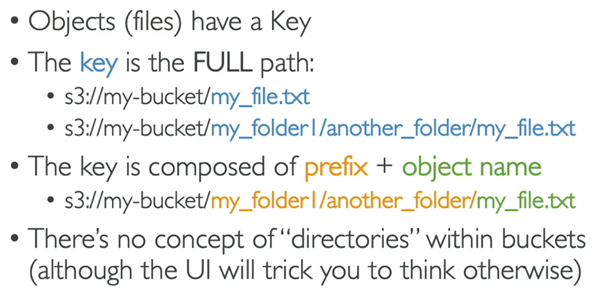
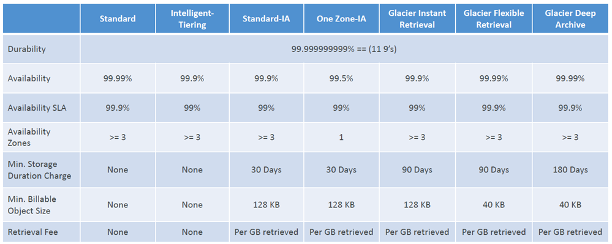
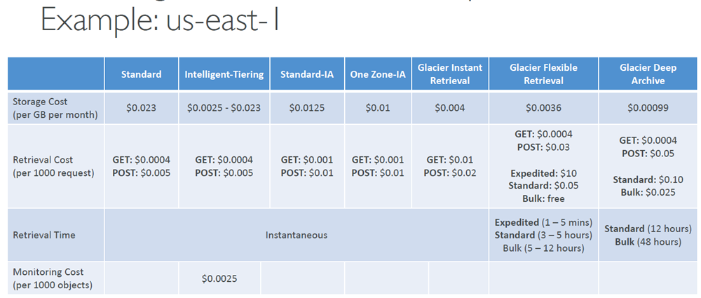

# Amazon S3

## At a glance
- S3 stores objects in buckets, with keys rather than filesystem directories.
- Access depends on applicable identity, resource, organization, endpoint, and encryption-key controls.
- Versioning and replication support recovery and copying, but do not prevent every form of loss.
- Storage classes and lifecycle rules trade cost against access, restore time, and resilience.

## Buckets and objects
- **Amazon Simple Storage Service (S3)** 
  - is highly scalable object storage.
  - Common uses include 
    - backups, 
    - disaster recovery, 
    - archives, 
    - static website assets, 
    - software distribution, 
    - media, 
    - data lakes, and 
    - application data.
  - S3 integrates with many AWS analytics, logging, and event services.
  
  - A bucket is `created in a selected AWS Region`.
  - Bucket `names are shared` across the applicable S3 namespace and must follow current naming rules; historically, standard `bucket names were globally unique`.
  - AWS has introduced `account-regional bucket namespaces` in some contexts, so verify the namespace and rules for the bucket type in use.
  - Names are DNS-compatible (for example, 
    - no Uppercase
    - No underscores
    - Not an IP
    - Must start with lowercase letter or number
    - Must NOT start with the prefix `xn--`
    - Must NOT end with the suffix `-s3alias`
    - and some prefixes/suffixes are reserved.
  
- **An object** is identified by its `bucket and key`.
  - The `key is the full object name`, often written as a slash-separated path such as `reports/2026/july.csv`.
  - S3 is object storage, not a hierarchical filesystem: the apparent `“folders” are prefixes in keys`, although the console can present them as folders.

      

  - An object contains its data (body):
    - max size `50TB`
    - If uploading more than `5GB`, must use “`multi-part upload`”
  - system metadata (such as content type and modification information), optional user-defined metadata, optional tags (up to `10`), and, when versioning is enabled, a version ID.
  - `Tags are Unicode key-value` labels associated with an object and are useful for lifecycle filtering, organization, and some access-control conditions.
  - Metadata and tags are not a general-purpose searchable index; maintain an external index such as DynamoDB when applications need search by object attributes.

## Access control and encryption
- Access may be controlled by 
  - `identity-based`
    * IAM Policies – which API calls should be allowed for a specific user from IAM
  - `resource-based` 
    * Bucket Policies – bucket wide rules from the S3 console - allows cross account
    * Object Access Control List (ACL) – finer grain (can be disabled)
    * Bucket Access Control List (ACL) – less common (can be disabled)

- `ACLs exist for legacy or specialized use`, but modern configurations commonly disable ACLs with S3 Object Ownership set to **Bucket owner enforced**.
- An identity's effective access depends on all applicable policy layers, including IAM identity policies, bucket/access-point policies, permissions boundaries, organization controls, and endpoint policies.
- An explicit `deny overrides an allow`.
- `Cross-account access` generally needs: 
  - the resource `owner's permission` and 
  - permission for the `caller's identity`, 
  - along with any `organization or encryption-key` permissions.
- Note: an IAM principal can access an S3 object if
  * The user IAM permissions ALLOW it OR the resource policy ALLOWS it
  * AND there’s no explicit DENY
- Use `S3 bucket for policy` to:
  - Grant public access to the bucket
  - Force objects to be encrypted at upload
  - Grant access to another account (CrossAccount)
- For an AWS workload such as EC2, use an IAM role rather than embedding long-term access keys.
- Bucket settings for `Blockin Public Access`
  - Always Block S3 Public Access enabled unless public access is a deliberate, reviewed requirement.
  - It can be configured at `account level` or `bucket level` and blocks common paths by which policies or ACLs could expose data.
- `S3 encrypts new objects at rest by default` with SSE-S3.
- Other choices include SSE-KMS/DSSE-KMS, SSE-C, and client-side encryption; see the security lesson for key ownership, request behavior, and trade-offs.
- TLS protects data in transit.

https://www.udemy.com/course/aws-certified-developer-associate-dva-c01/learn/lecture/11851546#overview

## Static website hosting
- `S3 can serve static website files` from a bucket after website hosting is enabled and an index document is configured.
- A `403` can indicate 
  - missing `read permission`, 
  - a `blocked public policy` (should allow public reads), or 
  - a request for an `object that does not exist` (depending on what the requester is allowed to learn).
- Website endpoints use HTTP; use CloudFront in front when HTTPS, a custom domain, caching, or additional edge protections are required.
- Direct public website access requires suitable `bucket permissions and Block Public Access` settings that do not block the intended public policy.
- Static website hosting does not run server-side application code. A separate API or compute service is needed for dynamic behavior.

## Versioning
- `Versioning is configured per bucket`.
  - With versioning enabled, `overwriting a key creates a new version instead of destroying` the old one; 
  - an `ordinary delete adds a delete marker` that hides the current version.
  - `Previous versions can be restored` or permanently deleted as permitted.
- Objects that `existed before versioning` was enabled 
  - have a `null` version.
  - `Suspending versioning` stops creation of new numbered versions but `does not erase existing versions`.

## Replication
- Types:
  - `Same-Region Replication (SRR)` and 
  - `Cross-Region Replication (CRR)` 
- Operation:
  - `asynchronously` copy eligible objects between buckets.
  - Must `Enable versioning` on both source and destination, 
  - configure an IAM role for S3 replication, and 
  - ensure destination policies and encryption keys allow the operation.
  - Buckets may be in separate accounts.
- Use cases:
  - `CRR` – compliance, lower latency access, replication across accounts
  - `SRR` – log aggregation, live replication between production and test accounts
- When you enable Replication:
  - By default it `applies to new objects` after configuration; 
  - use `S3 Batch Replication for existing objects` or failed replication.
  - For Delete:
    - `Delete-marker` replication is `optional`.
    - A `delete that specifies a version ID is not replicated`, helping prevent a permanent source-version deletion from automatically removing the replica.
  - Replication `does not automatically chain` through multiple replication rules/buckets.
    - If bucket 1 has replication into bucket 2, which has replication into bucket 3
    - Then objects created in bucket 1 are not replicated to bucket 3

## Storage classes and data resilience

### Lifecycle configurations
  - Can do:
    - transition objects between eligible classes, 
    - expire them, 
    - clean up noncurrent versions, and 
    - abort incomplete multipart uploads.

### Drurability
  - Durability concerns the `likelihood that data remains intact`; 
  - How many times an object is going to be lost by S3
  - High durability (99.999999999%, `11 9’s`)
  - 11 9's is not a guarantee that accidental deletion, wrong permissions, or customer-caused loss is impossible.

### Availability
  - availability concerns whether it can be accessed at a given time.
  - Measures how readily available a service is
  - Availability varies by class and service commitments.

### Clases
  - **S3 Standard** 
    - General purpose; suits frequently accessed data 
    - 99.99% Availability
    - low latency 
    - high throughput
    - and multi-AZ resilience.
    - `Use Cases`: Big Data analytics, mobile & gaming applications, content distribution…
  - **S3 Standard-IA** 
    - suits Infrequently Accessed (IA) data that still needs rapid retrieval, such as disaster-recovery copies.
    - For data that is less frequently accessed, but requires rapid access when needed
    - Lower cost than S3 Standard
    - 99.9% Availability
    - It has retrieval charges and minimum storage-duration/size billing rules.
    - `Use cases`: Disaster Recovery, backups
  - **S3 One Zone-IA** 
    - stores data in one AZ and can be appropriate for replaceable or separately replicated data; it is not suitable as the only copy of irreplaceable data.
    - High durability (99.999999999%) in a single AZ;
    - data lost when AZ is destroyed
    - 99.5% Availability
    - `Use Cases`: Storing secondary backup copies of on-premises data, or data you can recreate
  - **S3 Glacier Storage**
    - Low-cost object storage meant for archiving / backup
    - Pricing: price for storage + object retrieval cost
    - Types:
      - **S3 Glacier Instant Retrieval** 
        - is for rarely accessed archives that still require millisecond access.
        - Millisecond retrieval, great for data accessed once a quarter
        - Minimum storage duration of 90 days
      - **S3 Glacier Flexible Retrieval** and 
        - Expedited (1 to 5 minutes), Standard (3 to 5 hours), Bulk (5 to 12 hours) – free
        - Minimum storage duration of 90 days
      - **S3 Glacier Deep Archive** 
        - are archival tiers with restore delays ranging from minutes/hours to longer windows, and retrieval charges.
        - Standard (12 hours), Bulk (48 hours)
        - Minimum storage duration of 180 days
  - **S3 Intelligent-Tiering** 
    - automatically moves eligible objects among access tiers as access patterns change, for a monitoring/automation charge.
    - There are no retrieval charges in S3 Intelligent-Tiering
    - It is useful when access is unpredictable; optional archive tiers have restore behavior, so check which tier is enabled.
    - Options:
      - **Frequent Access** tier (automatic): default tier
      - **Infrequent Access** tier (automatic): objects not accessed for 30 days
      - **Archive Instant Access** tier (automatic): objects not accessed for 90 days
      - **Archive Access** tier (optional): configurable from 90 days to 700+ days
      - **Deep Archive Access** tier (optional): config. from 180 days to 700+ days

## Caveats and exam gotchas
- Versioning helps recover from accidental changes/deletes, but it is not a backup against every event: a principal with permission to delete versions can permanently remove them.
- Choose a class based on access frequency, required retrieval time, resilience, minimum-duration charges, and restore requirements—not storage price alone.
- Exact service limits, retrieval times, and pricing can vary and change.
