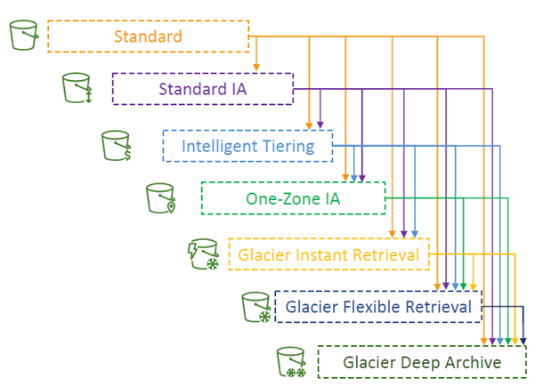
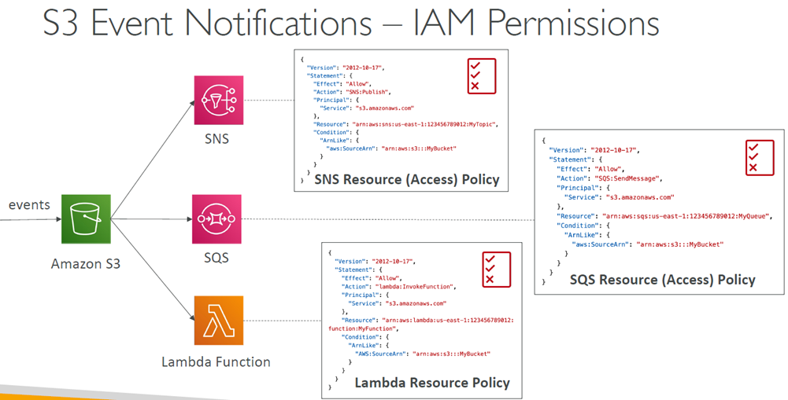
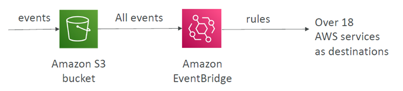
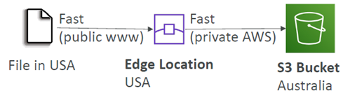

# Amazon S3 – Advanced

## At a glance
- Lifecycle rules transition, expire, and clean up eligible objects and versions.
- S3 events integrate with Lambda, SQS, SNS, and EventBridge; consumers should tolerate duplicate delivery.
- Multipart upload, Transfer Acceleration, and byte-range GETs address different transfer needs.
- Metadata and tags describe/classify objects but are not a general searchable index.

## Lifecycle rules and storage analysis
- `S3 Lifecycle configurations` 
  - Automate transitions between eligible storage classes and object expiration.
  - Rules can apply to an entire bucket or be scoped by prefix and/or object tags.
  - In versioned buckets, rules can separately transition or expire noncurrent versions and remove expired delete markers.
  - Consider minimum storage-duration charges, minimum billable object sizes, retrieval charges, and operational recovery time before moving data.
  - Rules can be created for:
    - `a certain prefix` (example: s3://mybucket/mp3/*)
    - `certain objects Tags` (example: Department: Finance)
  - Versioning can provide a recovery window for deleted data: a delete marker hides the current key while prior versions remain.
    - A lifecycle rule can transition noncurrent versions to lower-cost storage and expire them after the retention period.
    - This is different from an immediate permanent delete of a specific version.
- `Transitions Actions` 
  - `configure objects to transition to another storage class`
  - they are useful when access `becomes less frequent` over time; expiration is useful for data with a defined retention period.
  - Lifecycle policies can also abort incomplete multipart uploads, reclaiming storage from uploads that never completed.
- A transition does not make an archive immediately readable in the same way as Standard.
- `Expiration actions`
  - `configure objects to expire (delete) after some time`
  - Access log files can be set to delete after a 365 days
  - Can be used to delete old versions of files (if versioning is enabled)
  - Can be used to delete incomplete Multi-Part uploads
  
- `S3 Storage Class Analysis` 
  - helps determine whether `Standard` data may suit `Standard-IA`.
    - Does NOT work for `One-Zone IA` or `Glacier`
  - It aggregates usage rather than giving instant per-request decisions; `reports` = daily and have a startup/refresh delay and it does not analyze all storage classes.
  
https://www.udemy.com/course/aws-certified-developer-associate-dva-c01/learn/lecture/23743678#overview

## Events and integration
- S3 Event Notifications can `report events` such as object 
  - creation, 
  - deletion, 
  - restoration, and 
  - replication.
- Notifications may be `filtered by prefix or suffix` and sent to 
  - **Lambda**, 
  - **SQS**, or 
  - **SNS**.
- `Delivery` tipically `within seconds` and `may be delayed`; 
- `consumers` should be 
  - idempotent and 
  - tolerate duplicate or 
  - out-of-order notifications.
- Configure the `destination's resource policy` to allow S3 to publish or invoke it.

  

- `Amazon EventBridge` can `receive S3 events` and supports:
  - richer event-pattern filtering = options with JSON rules (metadata, object size, name...)
  - multiple AWS service destinations, 
  - archive/replay, and 
  - routing workflows.
- Choose it when more flexible filtering or fan-out is useful; a direct notification is simpler for a small number of supported targets.

  

## Request performance and transfers
### Baseline Performance
- S3 automatically scales to high request rates.
- Request distribution across prefixes can matter for workloads with very high concurrency.
- Your application can achieve at least `3,500 PUT/COPY/POST/DELETE` or `5,500 GET/HEAD` requests `per second per prefix` in a bucket.
- There are `no limits` to the `number of prefixes` in a bucket.
- Avoid sequential key designs when a workload shows a real hot-prefix bottleneck; 

- Example (object path => prefix): If you spread reads across all 4 prefixes evenly, you can achieve `22,000` requests per second `for GET and HEAD`
  - bucket/folder1/sub1/file => /folder1/sub1/
  - bucket/folder1/sub2/file => /folder1/sub2/
  - bucket/1/file => /1/
  - bucket/2/file => /2/

  
### Multipart upload
  - divides a `large object into parts` that can be transferred in parallel and retried independently.
    - `recommended` for files `> 100MB`,
    - `must` use for files `> 5GB`
  - It can improve throughput and resilience; complete the upload to assemble the object, or abort it to remove stored parts.
  - Set lifecycle cleanup for abandoned multipart uploads. Use multipart upload for large files and obey the current size/part limits.
- `S3 Transfer Acceleration` 
  - It can `improve long-distance uploads` by sending `data to an AWS edge location` before it `travels over the AWS network` to the bucket's Region.
  - It must be enabled for the bucket and uses a special endpoint; test from the relevant client locations because it is not beneficial for every path.
  - It is compatible with multipart upload.

  

### Byte-Range Fetches
  - `Parallelize GETs` by requesting specific byte ranges
  - They can parallelize downloads, retry only a failed range, or retrieve just a header/portion of a large file.
  - The application must reassemble ranges correctly if it needs the complete object.
  - Use cases:
    - `Speed up` downloads
    - `Retrieve only partial` data

## Object metadata and tags
- You cannot search the object metadata or object tags
- S3 does not provide a general query facility to search all objects by metadata or tags.
- If users need to find objects by arbitrary properties, update a separate searchable catalog (such as DynamoDB) when objects are created, changed, or deleted, and account for consistency and reconciliation.
 
### User-defined metadata
  - it is supplied `during upload` as `key-value pairs` using headers with the `x-amz-meta-` prefix.
  - S3 stores user metadata names in `lowercase`.
  - Metadata is returned with object reads/head operations and `is not a mutable` free-form index; changing it generally requires copying/replacing the object with updated metadata.
### Object tags
  - Object tags are separate key-value attributes (with current service limits on count and key/value sizes).
  - Tags are especially `useful for lifecycle filters`, cost organization, and tag-based authorization conditions.
  - Useful `for analytics purposes` (using S3 Analytics to group by tags)
  - Metadata can describe content; tags often classify it for management.

## Caveats and exam gotchas
- Do not assume that every event is delivered synchronously with the object API response.
- Older fixed per-prefix rates shown in course material should not be treated as current limits.
- Treat slide-era Storage Class Analysis timing claims as approximate and consult current documentation.
