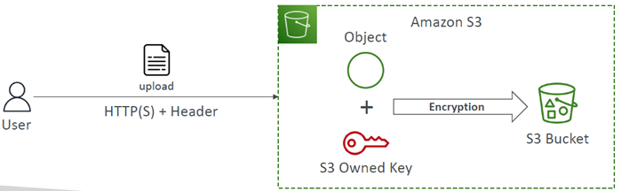
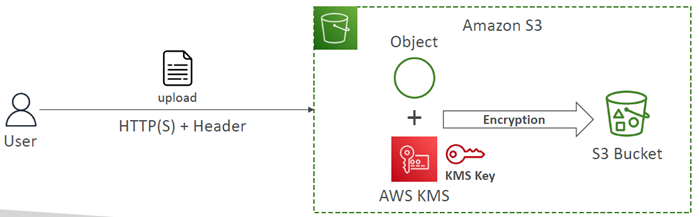
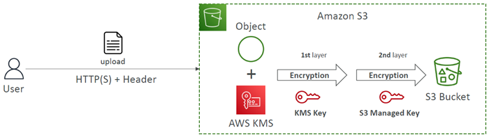
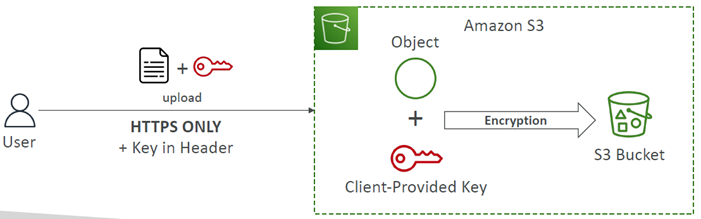
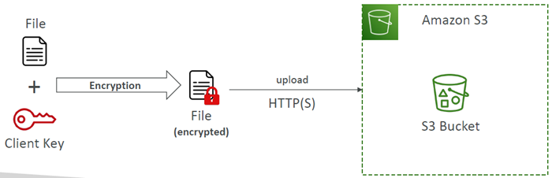
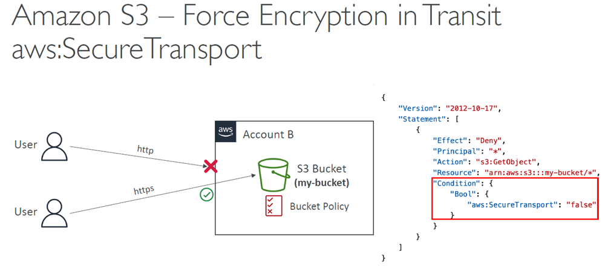
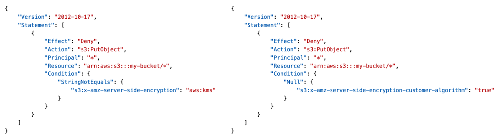
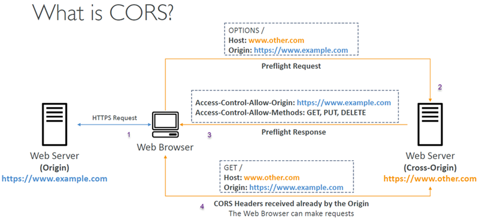

# Amazon S3 – Security

## At a glance
- S3 encryption options differ in who controls keys and where encryption occurs.
- Bucket policies can enforce TLS and encryption requirements, but must match upload behavior.
- CORS governs browser cross-origin behavior; it does not authorize S3 access.
- Presigned URLs, access points, and Object Lambda provide scoped access or transformation patterns.

## Encryption options
- S3 supports 
  - `server-side encryption (SSE)`, where S3 encrypts an object as it stores it and decrypts it for authorized reads, and 
  - `client-side encryption`, where the application encrypts before sending data to S3.

- Encryption types:
  - **SSE-S3** 
    - Enabled `by Default`
    - uses keys `managed by S3/AWS` and `AES-256` encryption.
      - Must set header `"x-amz-server-side-encryption": "AES256"`
    - `It is the default` server-side encryption for new objects.
    - Clients generally do not need to specify an encryption header just to receive this default.
  
      

  - **SSE-KMS** 
    - `uses an AWS KMS` key.
    - It provides `additional key-policy and IAM control` and records KMS `key usage in CloudTrail`.
    - Must set header `"x-amz-server-side-encryption": "aws:kms"`
    - The caller, S3, and key policy must permit the relevant operations.
    - KMS Limitations:
      - When you `upload`, it calls the `GenerateDataKey KMS API`
      - When you `download`, it calls the `Decrypt KMS API`
      - Count towards the KMS quota per second (5500, 10000, 30000 req/s based on region)
      - KMS request quotas and encryption-context/key policies can matter for high request volumes.

      

  - **DSSE-KMS** 
    - applies `dual-layer server-side encryption` with `KMS and S3-managed` encryption layers.
    - Must set header `"x-amz-server-side-encryption": "aws:kms:dsse"`
    - `Use it where a compliance requirement calls for dual-layer encryption`; 
    - it may add cost/latency and does not remove the need to authorize KMS use.
  
      

  - **SSE-C** 
    - uses a `key supplied by the customer` in `each request`.
    - `S3 does not retain the key`, so the customer must securely retain it and supply the correct key for subsequent reads and related operations.
    - `HTTPS is mandatory` because the key is sent in request headers.
    - Losing the key means the encrypted object cannot be decrypted.
    - Encryption key must provided in HTTP headers, for every HTTP request made

      

  - **Client-side encryption** 
    - `encrypts` content in the application `before upload and decrypts after` download.
    - The `customer controls` the cryptographic `implementation and key lifecycle`; 
    - S3 stores ciphertext and cannot recover plaintext if customer keys are lost.
  
      

- Notes:
  - These approaches differ mainly in who controls and retains keys and where encryption/decryption occurs.
  - SSE-S3 is the straightforward default; 
  - SSE-KMS adds key-level control and auditability; 
  - SSE-C and client-side encryption transfer more key-management responsibility to the customer.

## Encryption in transit and upload requirements
- `Encryption in flight` is also `called SSL/TLS`
- Use HTTPS/TLS to protect data in transit.
-` SSE-C` requires `HTTPS`.
- A bucket policy can deny requests when `aws:SecureTransport` is false, enforcing TLS for the bucket.
  
  

- `SSE-S3 encryption` is automatically applied to new objects by default, but a bucket policy can require clients to use a specific encryption method or KMS key.
- Optionally, `you can “force encryption”` using a `bucket policy` and refuse any API call to PUT an S3 object without encryption headers
- Note: `Bucket Policies are evaluated` before `“Default Encryption”`
  - so a PUT without the required header can be rejected even though S3 would otherwise apply default encryption.
- `Existing objects are not retroactively re-encrypted` simply `by changing bucket defaults`.
  - This action creates a new version of the object with updated settings and a new last-modified-date

  

## CORS for browser access
- **Cross-Origin Resource Sharing (CORS)** 
  - is a browser security mechanism for `requests made from one origin to another`.
  - Origin = scheme (protocol) + host (domain) + port; changing any of these makes it a different origin.
    - For example, two sites on different subdomains are cross-origin even if owned by the same organization.
    - Same origin: http://example.com/app1 & http://example.com/app2
    - Different origins: http://www.example.com & http://other.example.com
  - If browser code loaded from one origin needs to call an S3 bucket at another origin, configure the bucket's CORS rules to allow the requesting origin, HTTP methods, and any needed request/response headers.
    - The browser may send a preflight `OPTIONS` request before the actual request.
  
  

- If a client makes a cross-origin request on our S3 bucket, we need to enable the correct CORS headers
- CORS controls whether browsers may make/read cross-origin requests; it does **not** grant S3 authorization.
  - IAM, bucket/access-point policies, and object permissions must still allow the operation.
  - Conversely, an authorized request from a non-browser client is not blocked by browser CORS rules.

## MFA Delete and access logging
- MFA Delete adds an MFA requirement for permanent deletion of an object version and for suspending bucket versioning.
  - Versioning must be enabled.
  - Enabling versioning and listing versions do not require MFA Delete.
  - Configuration is restricted to the root account owner through the supported process, so it is not a general per-user policy setting.
- S3 server access logging records requests made to a source bucket, including requests from different accounts and denied requests.
  - Deliver logs to a separate target bucket in the same Region and grant the required delivery permissions.
  - Delivery is best effort and may take time; do not rely on it as a real-time audit stream.
- Never set the logging destination to the bucket being logged.
  - The resulting log writes can themselves be logged, creating a recursive growth loop.
  - Protect the logging bucket and consider lifecycle retention and analysis tooling.

## Presigned URLs
- A presigned URL allows temporary access to a specific S3 operation and object without making the bucket public or distributing the signer's credentials.
  - It is signed by the AWS CLI, SDK, or console using the signer's credentials.
- The recipient's effective access is bounded by the signer's permissions and the URL's expiration, as well as bucket policy, explicit denies, and other applicable controls.
  - A URL can authorize an operation such as GET or PUT; it does not grant general bucket access.
- Anyone who obtains the URL can use it while it remains valid, so treat it like a bearer secret.
  - Keep expiration short, avoid logging or publishing it, and use HTTPS.
  - Temporary signing credentials may cause the URL to expire sooner than its configured maximum.
  - Exact console/CLI maximum durations depend on current tooling and credential type.
- Typical uses include giving an authenticated user a private download link or allowing a client to upload to one designated object key without exposing AWS credentials.

## Access points and Object Lambda
- S3 Access Points provide distinct DNS endpoints and policies for different applications or teams using the same bucket.
  - For example, finance and sales access points can each grant access to a different prefix, simplifying policy administration compared with one large bucket policy.
- An access-point policy is an additional access-control layer, not a bypass around the underlying bucket policy or IAM permissions.
  - A request must pass the applicable authorization checks.
- A VPC-origin access point restricts access to a VPC path.
  - The VPC needs an S3 VPC endpoint (gateway or interface, as applicable), and its endpoint policy must allow the intended access point and bucket.
  - Access-point, bucket, endpoint, and identity policies must agree.
- S3 Object Lambda uses a Lambda function with an Object Lambda Access Point to transform an object as it is retrieved.
  - It can redact sensitive fields, filter records, or convert data formats without maintaining a separate transformed copy.
  - The backing access point and Lambda permissions must be configured, and transformation adds processing latency and cost.
