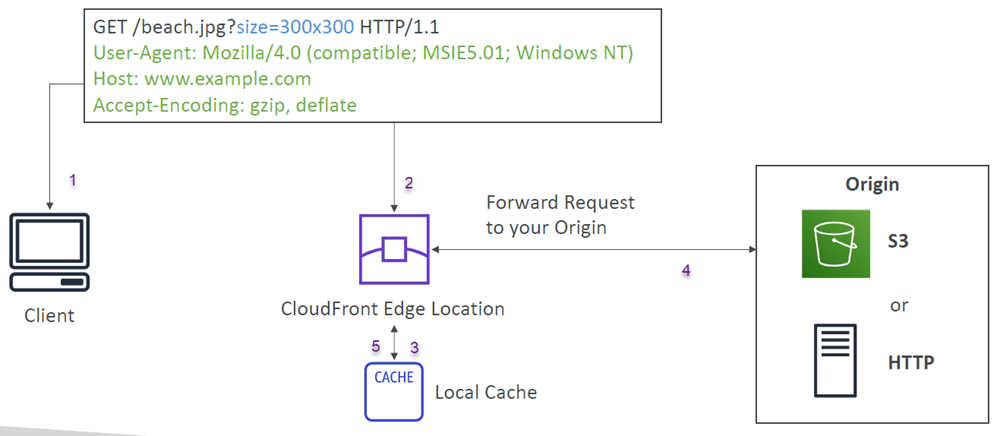
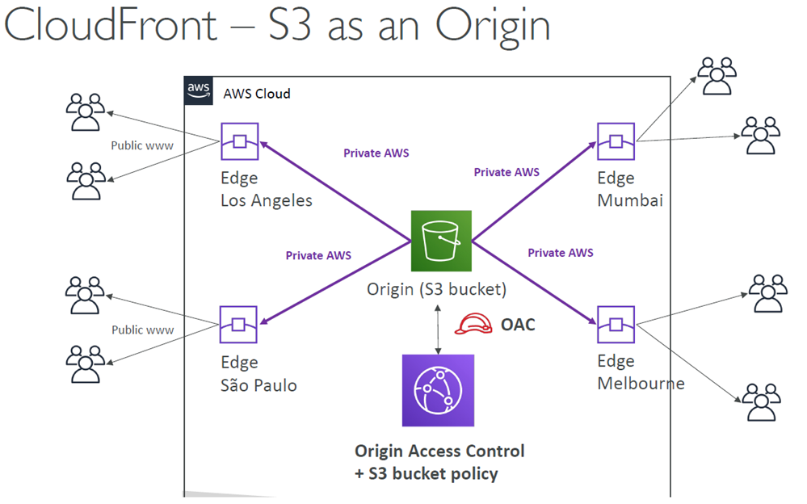
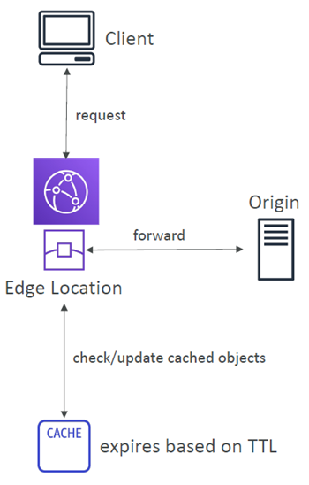
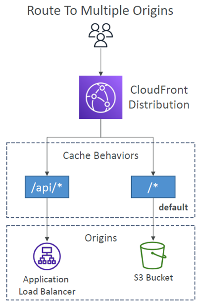
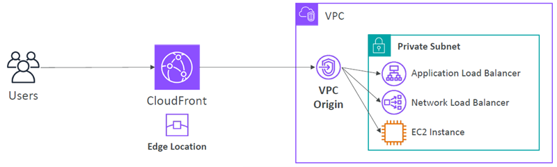
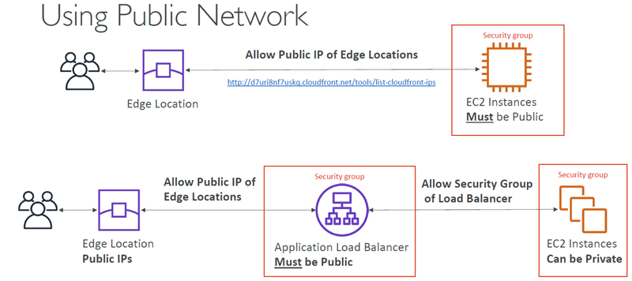
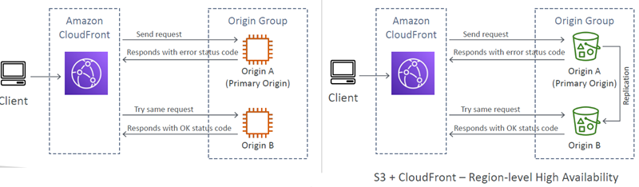
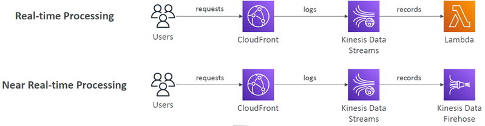

# Amazon CloudFront

## At a glance
- CloudFront `caches content at edge locations` to reduce viewer latency and repeated origin requests.
- Origins include S3, public HTTP services, and supported private VPC resources.
- Cache keys, cache behaviors, and policies determine what is cached and how requests reach origins.
- Access controls include geo restrictions, signed URLs/cookies, and field-level encryption.
- Delivery options include real-time logs and price classes with differing geographic coverage.

## CDN and origins
- CloudFront `is a content delivery network (CDN)`. 
- It `caches objects at edge locations` near viewers,` improving read latency` and `reducing repeated requests` to the origin.
- Its `globally distributed` edge network also helps absorb traffic spikes and 
- `DDoS protection` (due to worldwide) & `integrates with AWS Shield and AWS WAF for protection`.
- `An origin is the source` CloudFront fetches from on a cache miss. 
- Supported choices include:
  - `An S3` bucket.
    - For distributing files and caching them at the edge
    - For uploading files to S3 through CloudFront
    - Secured using Origin Access Control (OAC) and a bucket policy that grants the distribution access; do not make the bucket public.
  - `A public HTTP service`, 
    - including an S3 static website endpoint
    - Any public HTTP backend you want (example: Public ALB)
  - `A VPC origin` 
    - For applications hosted in VPC private subnets
    - targeting supported private ALBs, NLBs, or EC2 instances in private subnets. 
    - VPC origins avoid exposing an application directly to the public internet.

  

  

### CloudFront caching versus S3 replication

CloudFront:
- Global Edge network
- Files are cached for a TTL (maybe a day)
- Great for static content that must be available everywhere
- Provides a global edge cache

S3 Cross Region Replication:
- Must be setup for each region you want replication to happen
- Files are updated in near real-time
- Read only
- Great for dynamic content that needs to be available at low-latency in few regions
- Is not a global edge cache.

## Caching and behaviors
- `Each edge location maintains its own cache`.
- The `cache key` identifies an object; 
  - `identifier` for `every object` in the cache
  - by default it includes the distribution `hostname and URL path`.
- You `can invalidate part of the cache` using the `CreateInvalidation API`
- You can `Add headers, cookies, or query strings` to the `key` only when they genuinely change the response using <u>**CloudFront Cache Policies**</u>
- More key variations create more cache entries and lower the hit ratio.

### Cache Policy
- A cache policy controls the cache key and TTL:
  - TTL can be set from zero to one year.
  - Origin `Cache-Control` or `Expires` headers can influence caching within the policy's limits.
  - `Values added to the cache key are also forwarded to the origin` (included in origin request)
- Cache based on:
  - `HTTP Headers`:
    - `None`:
      - Don’t include any headers in the Cache Key (except default)
      - Headers are not forwarded (except default)
      - Best caching performance
    - `Whitelist`:
      - only specified headers included in the Cache Key
      - Specified headers are also forwarded to Origin
  - `Cookies`: None – Whitelist – Include All-Except – All
  - `Query Strings`:
    - `None`
      - Don’t include any query strings in the Cache Key
      - Query strings are not forwarded
    - `Whitelist`
      - Only specified query strings included in the Cache Key
      - Only specified query strings are forwarded
    - `Include All-Except`
      - Include all query strings in the Cache Key except the specified list
      - All query strings are forwarded except the specified list
    - `All`
      - Include all query strings in the Cache Key
      - All query strings are forwarded
      - Worst caching performance

- `An origin request policy forwards` selected viewer headers, cookies, and query strings `to the origin without varying the cache key`. 
- Use this `when the origin needs data for processing` but that `data should not create separate cached copies`.
- **Caution:** Forwarding per-user values while sharing a cache key can expose personalized content. Disable caching or include all response-varying values in the key for user-specific responses.
  
  

### Cache Invalidations
- `When an origin changes`, CloudFront does not automatically know that an object is stale. 
  - `Wait for its TTL` or create an invalidation for selected paths. 
  - `CloudFront Invalidation` is useful for `urgent updates`, but it is not a substitute for an appropriate TTL strategy.
  - You can invalidate all files (*) or a special path (/images/*)

### Cache Behaviors
- Cache behaviors `route path patterns to origins and settings`
  - based on the content type or path pattern
  - for example, `/images/*` to S3 and `/api/*` to an application origin.
- Behaviors are `evaluated in configured order`.
- The default `*` behavior is the fallback and effectively `comes last`.
- Separate static and dynamic traffic, or even distributions, when that improves the cache key and hit ratio.
- An origin group has a primary and secondary origin. CloudFront retries the same request against the secondary when the primary returns a configured failure status, improving availability.
- Pair regional S3 origins with replication when regional failover must serve equivalent data.

  

### ALB or EC2 as an origin Using VPC Origins
- Allows you to `deliver content` from your applications `hosted in your VPC` private subnets (`no need to expose them on the Internet`)
- Deliver traffic to `private`:
  - Application Load Balancer
  - Network Load Balancer
  - EC2 Instances

  

  

## Access, security, and delivery options
### Geographic restrictions
- `Geo restriction` can `allow only specified countries` or `block specified countries`.
- You can `restrict who can access` your distribution
  - `Allowlist`: Allow your users to access your content only if they're in one of the countries on a list of approved countries.
  - `Blocklist`: Prevent your users from accessing your content if they're in one of the countries on a list of banned countries.
- The viewer's `country is inferred` from a third-party` Geo-IP database`; this is a content-access control, not a precise identity check.

### Signed access
- `Signed URLs` grant `access` to an `individual file`; 
- `signed cookies` authorize `multiple files`, useful for a set of protected assets.
- We attach a policy with:
  - Includes URL expiration
  - Includes IP ranges to access the data from
  - Trusted signers (which AWS accounts can create signed URLs)
- Use short expiry for shared paid media and longer expiry only where the content and risk justify it.

#### CloudFront Signed URL vs S3 Pre-Signed URL
- `CloudFront Signed URL`:
  - Allow access to a path, no matter the origin
  - Account wide key-pair, only the root can manage it
  - Can filter by IP, path, date, expiration
  - Can leverage caching features
  - validated at the edge
  - can be used with different origin types while retaining CDN caching
- `S3 Pre-Signed URL`:
  - Issue a request as the person who pre-signed the URL
  - Uses the IAM key of the signing IAM principal
  - Limited lifetime

- Two types of signers:
  - Either a `trusted key group` (recommended)
    - Can leverage APIs to create and rotate keys (and IAM for API security)
  - `An AWS Account that contains a CloudFront Key Pair`
    - Need to manage keys using the root account and the AWS console
    - **Not recommended** because you shouldn’t use the root account for this
- Signed URL Process:
  - In your CloudFront distribution, `create one or more trusted key groups`
  - You generate your `own public / private key`
    - The private key is used by your applications (e.g. EC2) to sign URLs
    - The public key (uploaded) is used by CloudFront to verify URLs

### Pricing
- CloudFront Edge locations are all around the world
- The cost of data out per edge location varies
- You can reduce the number of edge locations for cost reduction
- `3 Price Classes` trade geographic coverage for cost:
  - **All** offers all edge locations.
  - **200** excludes the most expensive locations.
  - **100** uses the least expensive locations.

### Origin Groups for high-availability and failover
- Origin Group: one primary and one secondary origin
- If the primary origin fails, the second one is used

  

### Field-level encryption
- Field-level encryption adds` protection for selected form fields` in POST requests.
- It `supplements HTTPS` rather than replacing transport encryption.
- Uses asymmetric encryption
- CloudFront encrypts `up to 10 configured fields` at the edge `with a public key`; only an application component holding the private key can decrypt them.

### Real Time Logs
- `Real-time logs stream` selected viewer-request fields `to Kinesis Data Streams`.
- `Configure sampling` percentage, fields, and cache behaviors `to monitor` delivery performance without necessarily recording every request.
- Allows you to choose:
  - `Sampling Rate` – percentage of requests for which you want to receive
  - `Specific fields` and specific `Cache Behaviors` (`path patterns`)
- Kinesis Data Firehose can then deliver records onward for near-real-time processing or storage.

  