# Containers on AWS

## At a glance
- Docker images package applications and dependencies; ECR stores images, while ECS and EKS orchestrate workloads.
- Fargate supplies managed compute for ECS tasks or EKS pods without customer-managed hosts.
- ECS task definitions, IAM roles, networking, scaling, and placement determine how tasks run.
- EKS provides managed Kubernetes control planes and several worker-capacity options.
- Choose persistent storage, configuration, and deployment controls to match the workload.

## Images and AWS container services
### Docker
- Docker is a software development `platform to deploy apps`
- `Apps are packaged in containers` that can be run on `any OS`
- `Apps run the same`, regardless of where they’re run
  - Any machine
  - No compatibility issues
  - Predictable behavior
  - Less work
  - Easier to maintain and deploy
  - Works with any language, any OS, any technology
 
- Docker `packages` an application `and its dependencies` <u>`as an image`</u>, which can run as a container on different hosts with more consistent behavior.
- Unlike a virtual machine, a `container shares the host OS kernel`, so `multiple containers can use a host's resources` without each carrying a separate guest OS.

  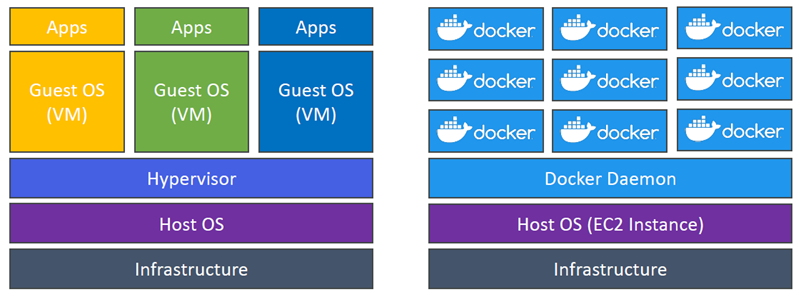

- `Docker images` are stored in `Docker Repositories`
  - `Docker Hub` (https://hub.docker.com)
    - `Public` repository
    - Find base images for many technologies or OS (e.g., Ubuntu, MySQL, …)
  - `Amazon ECR` (Amazon Elastic Container Registry)
    - `Private` repository
    - `Public` repository (Amazon ECR Public Gallery https://gallery.ecr.aws)

  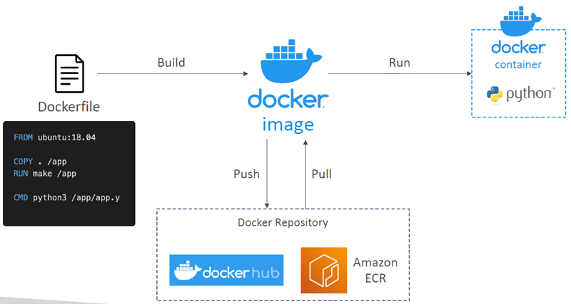

- Docker Containers Management on AWS:
  - Amazon Elastic Container Service (`Amazon ECS`)
    - Amazon’s own container platform
  - Amazon Elastic Kubernetes Service (`Amazon EKS`)
    - Amazon’s managed Kubernetes (open source)
  - `AWS Fargate`
    - Amazon’s own Serverless container platform
    - Works with ECS and with EKS
  - `Amazon ECR`:
    - Store container images
    - integrates with ECS, uses IAM for access, and supports image tags, scanning, and lifecycle policies.
    - If a host cannot pull an image, check its IAM permissions and registry authentication.

  

### Orchestrators and compute
| Service | Role |
| --- | --- |
| ECS | AWS's native container orchestrator. |
| EKS | AWS's managed Kubernetes service, useful when a team already operates Kubernetes or needs its ecosystem and API. |
| Fargate | Serverless compute that can run ECS tasks or EKS pods; it does not replace either orchestrator. |

- With EC2-backed workloads, you operate worker capacity; with Fargate, AWS operates the underlying hosts.

## ECS tasks, roles, and networking
### EC2 Launch Type
- `Launch Docker` containers `on AWS` = Launch `ECS Tasks on ECS` Clusters
- An ECS cluster groups capacity and tasks.
- A task definition is JSON metadata describing how to run one or more containers, including image, CPU and memory, ports, environment, networking, IAM role, and logging.
- A task definition can specify up to 10 containers, enabling tightly coupled patterns such as an application plus a log/metrics sidecar.
- `EC2 launch type` requires` EC2 instances registered to the cluster` and `running the ECS agent`. 
- `You manage host provisioning and patching`; 
- AWS takes care of starting / stopping containers
- ECS places and starts tasks.

  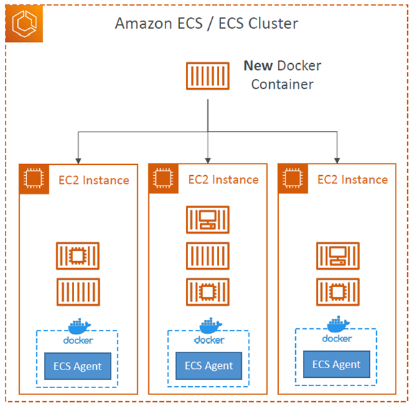


### Fargate Launch Type
- Fargate removes host management: specify the task's CPU and memory and ECS runs each task on managed infrastructure.
- You do not provision the infrastructure (no EC2 instances to manage)
- It’s all Serverless!
- You just create task definitions
- AWS just runs ECS Tasks for you based on the CPU / RAM you need
- To scale, just increase the number of tasks. Simple - no more EC2 instances

  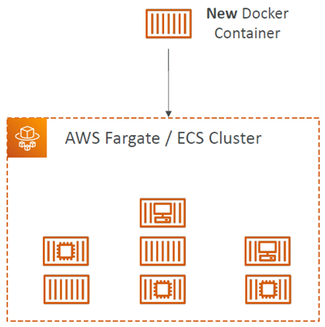


### IAM roles for EC2
- Distinguish the host instance profile from the task role.
- On `EC2 launch type`, the `instance profile` supports the `ECS agent`, for example, pulling ECR images or publishing logs.
- `EC2 Instance Profile` (EC2 Launch Type only):
  - Used by the ECS agent
  - Makes API calls to ECS service
  - Send container logs to CloudWatch Logs
  - Pull Docker image from ECR
  - Reference sensitive data in Secrets Manager or SSM Parameter Store

- The `task role` is assigned in the task definition and grants the application its own AWS permissions.
- Use separate least-privilege task roles for different services.
- `ECS Task Role`:
  - Allows each task to have a specific role
  - Use different roles for the different ECS Services you run
  - Task `Role` is defined in the `task definition` and `NOT in the Service`, service `inherits` the iam role from task definition

  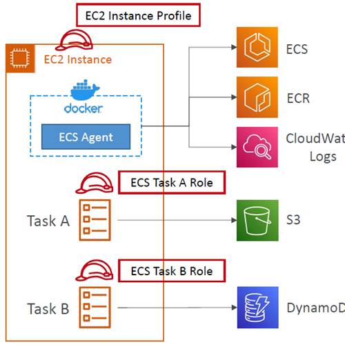

  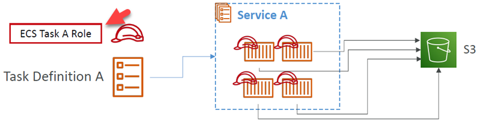


### Load balancing and security groups
- `ALB is the usual choice` for ECS web traffic.
- With EC2 tasks:
  - Omitting a fixed host port allows dynamic host-port mapping, so several tasks can share an instance.
  - The ALB target group routes to each assigned port.
  - The instance security group must permit traffic from the ALB security group to those ports.
- With Fargate:
  - Each task has its own ENI/private IP.
  - The task security group allows the application port from the ALB.
- `NLB is appropriate for high-throughput` or performance needs and PrivateLink.
- `Classic Load Balancer` is legacy and is not supported for Fargate.

### Storage and configuration
-` EFS mounts` provide persistent `shared` files `across Tasks and Availability Zones` and work with both `EC2 and Fargate`.
- Bind mounts `share task-local ephemeral data between containers`:
  - On `EC2`, their storage `lifetime` is tied to the `host instance`.
  - On `Fargate`, their storage `lifetime` is tied to `the task`.
- Fargate ephemeral storage defaults to 20 GiB and can be configured up to 200 GiB.
- Use an `S3-backed file system` where supported when container workloads need file-style access to S3 data.
  - Supported: `Fargate` and `ECS` Managed Instances
  - Not Supported: `EC2 launch type` 
- Put non-sensitive configuration in environment variables.
- Retrieve sensitive values from Systems Manager Parameter Store or Secrets Manager rather than hardcoding them; S3 environment files can supply bulk settings.

## ECS scaling, deployment, and placement
### Scaling and deployments
- `ECS Service Auto Scaling` changes the `desired number of tasks`, commonly using average `CPU, memory, or ALB requests` per `target`.
- Scaling policies include:
  - `Target tracking`, which follows a target metric value for a specific CloudWatch metric
  -` Step scaling`, which responds to CloudWatch alarm steps.
  - `Scheduled scaling`, which handles predictable demand based on a specified date/time
- `Task scaling` is separate <> from `EC2 Auto Scaling`:
- EC2 launch type may also require an Auto Scaling group or an ASG-backed capacity provider to add hosts when cluster capacity is insufficient.
- Fargate has no host fleet to scale and Fargate Auto Scaling is much easier to setup (serverless)
- `Auto Scaling EC2 Instances`
- Accommodate ECS Service Scaling by adding underlying EC2 Instances
  - `Auto Scaling Group` Scaling
    - Scale your ASG based on `CPU` Utilization
    - Add `EC2 instances over time`
  - `ECS Cluster Capacity Provider`
    - Used to `automatically provision and scale the infrastructure for your ECS Tasks`
    - Capacity Provider paired with an Auto Scaling Group
    - Add EC2 Instances when you’re missing capacity (CPU, RAM…)

- `Rolling service deployments` use `minimum healthy` and `maximum task percentages` to control `how many tasks may stop and start` during replacement.
- A more permissive maximum lets ECS start replacement tasks before stopping old ones, while a restrictive minimum can reduce capacity or slow the rollout.
- Choose settings that preserve the required availability and fit available capacity.

  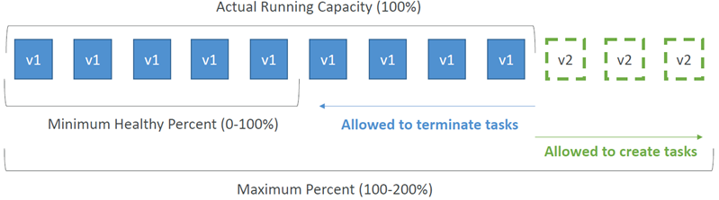

- `EventBridge` can run `scheduled` or `event-triggered` tasks and can `match stopped-task events` to notify an operator, for example `through SNS`.
  - Event:
    - 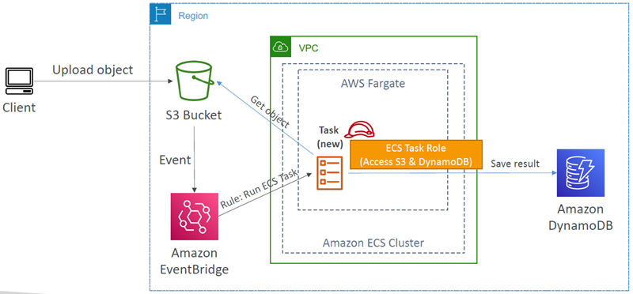
  - Scheduled:
    - 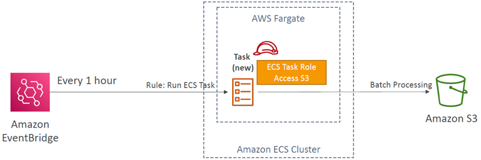
  - Intercept Stopped tasks
    - 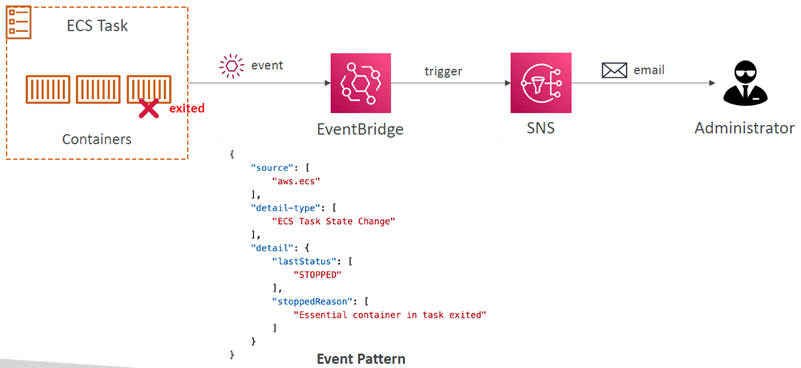

### ECS – Task Definitions
- `Task definitions` are metadata `in JSON form` to tell ECS `how to run` a Docker container
- It contains crucial information, such as:
  - Image Name
  - Port Binding for Container and Host
  - Memory and CPU required
  - Environment variables
  - Networking information
  - IAM Role
  - Logging configuration (ex CloudWatch)
- Can `define up to 10 containers` in a `Task Definition`

### ECS – Load Balancing 
#### (EC2 Launch Type)
- We get a `Dynamic Host Port Mapping if you define only the container port in the task definition`
- The `ALB finds the right port` on your `EC2 `Instances
- `You must allow` on the EC2 instance’s `Security Group` <u>**any port**</u> from the `ALB’s Security Group`

  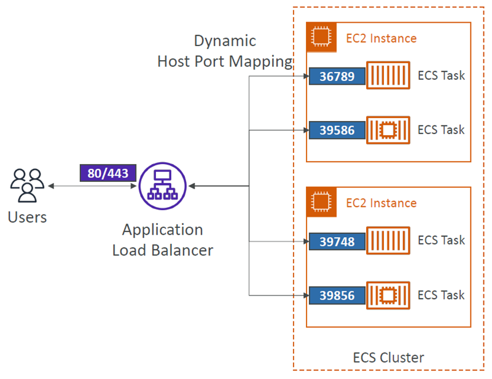

#### (Fargate)
- Each task has a `unique private IP`
- Only `define the container port` (`host port is not applicable`)
- Example
  - ECS ENI Security Group
    - Allow port 80 from the ALB
  - ALB Security Group
    - Allow port 80/443 from web

  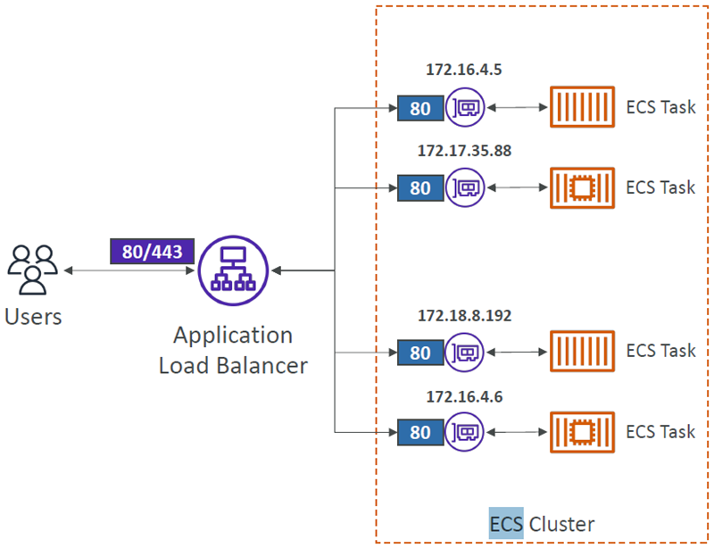


### ECS – Environment Variables
- Environment Variable
  - `Hardcoded` – e.g., URLs
  - `SSM Parameter` Store – sensitive variables (e.g., API keys, shared configs)
  - `Secrets Manager` – sensitive variables (e.g., DB passwords)
- `Environment Files` (bulk) – Amazon `S3`

  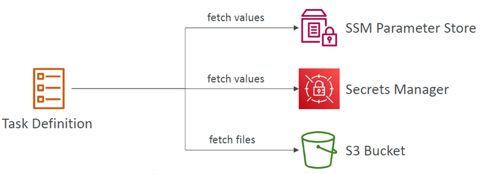


### ECS – Data Volumes (Bind Mounts)
- `Share data` between `multiple containers` in the `same Task Definition`
- Works for `both EC2 and Fargate` tasks
- `EC2 Tasks` – using EC2 instance storage
  - Data are tied to the lifecycle of the EC2 instance
- `Fargate Tasks` – using ephemeral storage
  - Data are tied to the container(s) using them
  - 20 GiB – 200 GiB (default 20 GiB)
- Use cases:
  - Share ephemeral data `between multiple containers`
  - `“Sidecar”` container pattern, where the “sidecar” container used to send metrics/logs to other destinations (separation of conerns)

  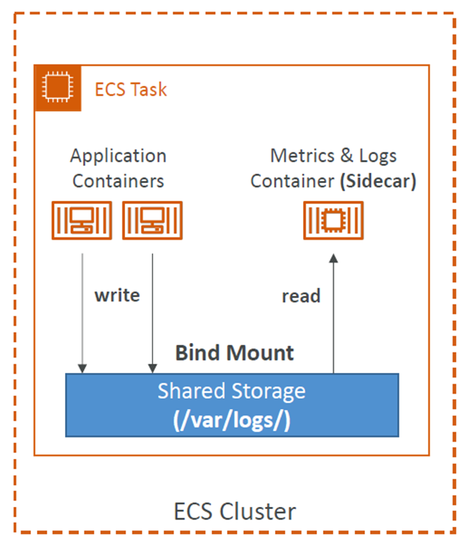


### ECS – Task Placement - Only EC2 Launch Type
- `When an ECS task is started` with EC2 Launch Type, `ECS must determine where to place it`, with the constraints of `CPU and memory (RAM)`
- Similarly,` when a service scales` in, `ECS needs to determine which task to terminate`
- You can define:
  - `Task Placement Strategy`
  - `Task Placement Constraints`
- Note: only for ECS Tasks with EC2 Launch Type (`Fargate not supported`)

#### Task Placement Process
- Task Placement Strategies are a` best effort`
- When Amazon ECS places a task, it` uses the following process to select` the appropriate EC2 Container instance:
1. Identify which instances that satisfy the `CPU, memory, and port` requirements
2. Identify which instances that satisfy the `Task Placement Constraints`
3. Identify which instances that satisfy the `Task Placement Strategies`
4. Select the instances

#### Task Placement Strategies
- ECS placement strategies and constraints `apply to EC2-backed tasks, not Fargate`.
- ECS first filters instances by CPU, memory, ports, and constraints.
- Strategies are best effort, not guarantees:
  - `binpack` - packs tasks onto the `least-free capacity` (CPU and Memory) `to reduce`/minimize the number of instances. Tries to fill the instance before it moves to the next instance.
  - `spread` - distributes tasks (tasks `placed evenly`) by a `selected attribute` such as` Availability Zone or instance`.
  - `random` - chooses `arbitrarily`.
  - `mix` - Strategies can be `combined`.
- `Constraints`:
  - `distinctInstance` places tasks on separate instances.
  - `memberOf` tasks placed on EC2 instances that satisfy a `specified expression` (using a `Cluster Query Language`)


## ECR
- ECR = Elastic Container Registry
- Store and manage Docker images on AWS
- `Private` and `Public` repository (Amazon ECR Public Gallery https://gallery.ecr.aws)
- Fully `integrated with ECS, backed by Amazon S3`
- `Access` is controlled `through IAM` (permission errors => policy)
- Supports image vulnerability scanning, versioning, image tags, image lifecycle, …

  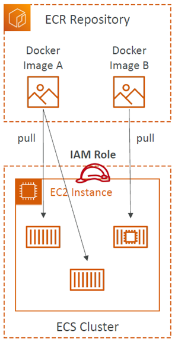

### ECR – Using AWS CLI
- Login Command
  - AWS CLI v2
    ```
    aws ecr get-login-password --region {region} | docker login --username AWS --password-stdin {aws_account_id}.dkr.ecr.{region}.amazonaws.com
    ```
- Docker Commands
  - Check docker version
  ```
  docker --version
  ```
  - Push
  ```
  docker push aws_account_id.dkr.ecr.region.amazonaws.com/demo:latest
  ```
  - Pull
  ```
  docker pull aws_account_id.dkr.ecr.region.amazonaws.com/demo:latest
  ```
  - Tag your image
  ```
  docker tag {demosname:latest} {aws_account_id}.dkr.ecr.{region}.amazonaws.com/{demosname:latest}
  ```
- In case an EC2 instance (or you) can’t pull a Docker image, `check IAM permissions`

  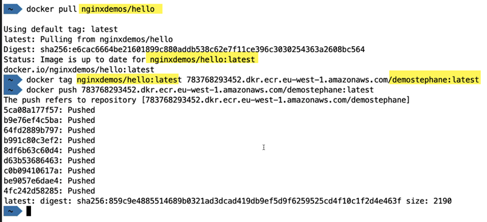

  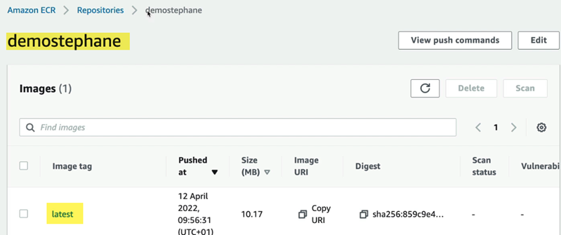


## EKS
- Amazon EKS = Amazon Elastic Kubernetes Service
- EKS runs managed Kubernetes control planes; 
- Kubernetes is an open-source system for automatic deployment, scaling and management of containerized (usually Docker) application
- Kubernetes supplies the orchestration API, while ECS uses AWS's own task/service model.
- It is a way to launch `managed Kubernetes clusters` on AWS
- EKS `supports EC2` if you want to deploy worker nodes `or Fargate` to deploy serverless containers
- Kubernetes is `cloud-agnostic` (can be used in any cloud – Azure, GCP…)
- For multiple regions, deploy one EKS cluster per region
- Collect `logs and metrics using CloudWatch Container Insights`
- Choose EKS `when portability or an existing Kubernetes` operating model matters; choose ECS when AWS-native orchestration is the simpler fit.
- Use case: 
  - if your company is already using Kubernetes on-premises or in another cloud, and wants to migrate to AWS using Kubernetes

### EKS – Node Types
- `Managed Node Groups`
  - Creates and manages Nodes (EC2 instances) for you
  - Nodes are part of an ASG managed by EKS
  - Supports On-Demand or Spot Instances
- `Self-Managed Nodes`
  - Nodes created by you and registered to the EKS cluster and managed by an ASG
  - You can use prebuilt AMI - Amazon EKS Optimized AMI
  - Supports On-Demand or Spot Instances
- `AWS Fargate`
  - No maintenance required; no nodes managed

### EKS – Data Volumes
- EKS persistent storage uses `Kubernetes StorageClass` configuration and a `Container Storage Interface (CSI) driver`.
- Support for…
  - Amazon `EBS`
  - Amazon `EFS` (works with Fargate)
  - Amazon `FSx for Lustre`
  - Amazon` FSx for NetApp ONTAP`

