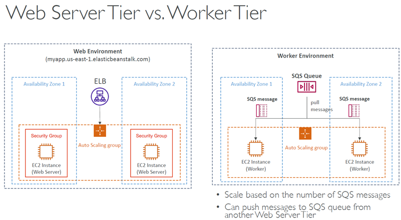
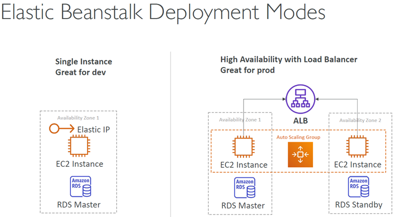
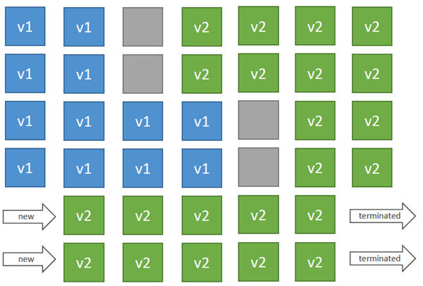
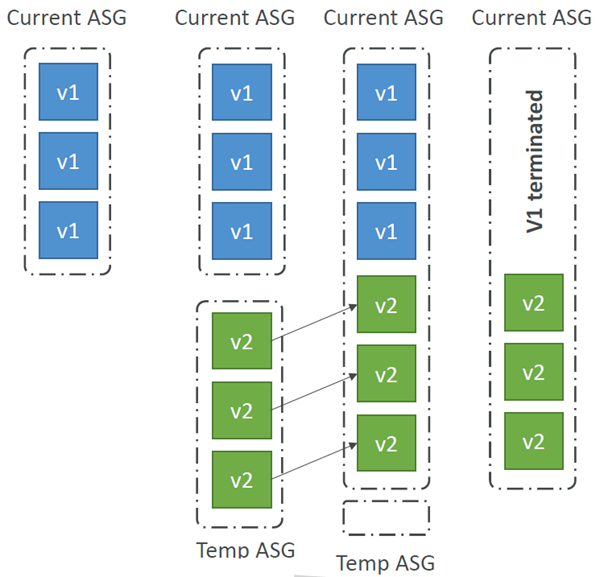
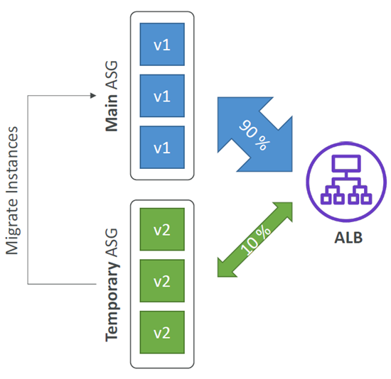
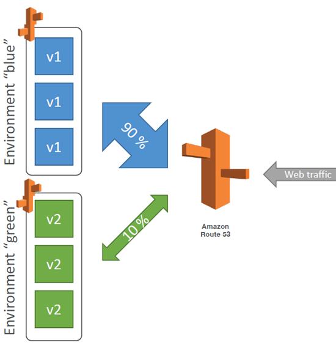
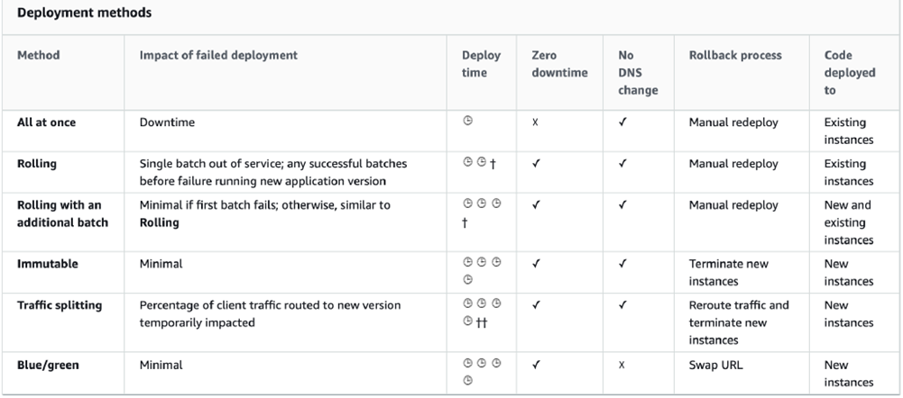

# AWS Elastic Beanstalk

https://www.udemy.com/course/aws-certified-developer-associate-dva-c01/learn/lecture/11851294#overview

## At a glance
- Elastic Beanstalk `deploys applications` while `provisioning and managing common AWS infrastructure`.
- Applications group environments, configurations, and immutable application versions.
- Deployment strategies trade rollout speed, capacity, availability, and rollback behavior.
- The EB CLI, `.ebextensions/`, and CloudFormation support automation and configuration.
- Environment, load balancer, database, and version lifecycles have important operational caveats.
- Beanstalk uses CloudFormation underneath.

## Managed application deployment
- `Elastic Beanstalk` `offers a developer-focused way` to deploy applications on AWS `without manually coordinating` common infrastructure.
- It `provisions and manages` familiar services such as:
  -  EC2, 
  -  Auto Scaling groups, 
  -  load balancers, and 
  -  optionally RDS.
- Beanstalk `handles`: 
  - capacity, 
  - health monitoring, 
  - instance configuration, 
  - scaling, and 
  - deployment coordination; 
- developers can still configure the environment and retain control of its underlying resources.
- The Beanstalk `service is free`, but the `AWS resources it provisions are billed normally`.

## Beanstalk – Components
- `Application`: collection of Elastic Beanstalk components (environments, versions, configurations, …)
- `Application Version`: an iteration of your application code
- `Environment`
  - Collection of` AWS resources` running an `application version` (`only one` application version `at a time`)
  - `Tiers`: 
    - `Web Server` Environment Tier & 
    - `Worker` Environment Tier
  - You can create `multiple environments` (dev, test, prod, …)
- Choose a `supported platform` for the application, for example:
  -  Go
  - Java SE, Java with Tomcat
  - .NET Core on Linux, .NET on Windows Server
  - Node.js
  - PHP
  - Python
  - Ruby
  - Packer Builder
  - Single Container Docker, Multi-container Docker, Preconfigured Docker
- Upload a source bundle, commonly a ZIP containing the application and dependency manifest.

    

### Applications and environments
- An application groups its 
  - environments, 
  - configurations, and 
  - application versions.
- An `application version is an immutable` packaged code revision.
- `Each environment runs one version` at a time, allowing independent dev, test, and production environments.
- Web server environments accept application traffic and commonly use an ALB with an Auto Scaling group.
- Worker environments poll an SQS queue and process background jobs; they can scale based on queue depth.
- A web tier can enqueue work so request-serving capacity is not tied to long-running background processing.
- A single-instance environment is useful for development and testing.
- A load-balanced, multi-instance environment across Availability Zones is the normal production shape when high availability is required.

    

## Deployment strategies
### All at once
  - **How it deploys:** Updates all instances together.
  - **Considerations:** 
    - `Fastest` and requires `no extra capacity`, but 
    - the `application is unavailable during replacement`; 
    - best reserved for non-critical development deployments and quick iterations
    - `No additional cost`

    

### Rolling
  - **How it deploys:** Replaces instances in batches.
  - **Considerations:** 
    - The application can temporarily `run below` full `capacity`, and 
    - `both` old and new versions may `serve traffic` during rollout. 
    - Application is running `both versions simultaneously`
    - `Batch size` controls the capacity dip and duration; 
    - Long deployment
    - there is `no extra instance cost`.

    

### Rolling with additional batches
  - **How it deploys:** Launches temporary extra instances to receive updated batches, `keeping the original fleet at capacity`.
  - **Considerations:** 
    - Application is running `at capacity`
    - Can set the` bucket size`
    - Application is running `both versions` simultaneously
    - Small `additional cost`
    - Additional batch is removed at the end of the deployment
    - Longer deployment
    - Good for prod
    - Costs more during rollout and takes longer, then removes the extra capacity.

    

### Immutable
  - **How it deploys:** Launches a temporary Auto Scaling group, deploys the new version there, and `switches only when the new instances are healthy`.
  - **Considerations:** 
    - `Avoids downtime (zero downtime)` and makes` rollback quick` by discarding the temporary ASG 
    - New Code is deployed to new instances on a temporary ASG
    - temporarily needs close to double capacity and `is the longest`
    - `most resource-intensive strategy`.
    - Great for prod

    

### Traffic splitting (canary)
  - **How it deploys:** `Deploys the new version` to a `temporary fleet and sends it a small configurable percentage` of requests for a period.
  - **Considerations:** 
    - `Canary` Testing
    - New application version is `deployed to a temporary ASG` with the `same capacity`
    - `Health is monitored`, and a failed deployment can trigger automatic rollback. 
    - `After success`, the new `instances move into the main fleet`. 
    - If there’s a deployment `failure`, this triggers an `automated rollback` (very quick)
    - This is a canary-style release, not merely replacing all instances at once.
    - `No application downtime`
    - `Old application` version is then `terminated`

    

### Blue/green environment pattern
  - Blue/green is an environment-level pattern, not a direct Beanstalk deployment mode.
  - `Create a separate environment` and validate it.
  - `Zero downtime` and release facility
  - Optionally `send a small share of traffic` through Route 53 weighted routing, `then switch environment` URLs or DNS.
  - `Keeping the old environment available` supports rollback.
  - The new environment `(green) can be validated independently` and roll back if issues
  - Route 53 can be setup using weighted policies to redirect a little bit of traffic to the stage environment
  - Using Beanstalk, “swap URLs” when done with the environment test

    

### Summary
https://docs.aws.amazon.com/elasticbeanstalk/latest/dg/usingfeatures.deploy-existing-version.html

## Configuration and lifecycle
### CLI
- The EB CLI streamlines automation with commands such as `eb create`, `eb status`, `eb health`, `eb events`, `eb logs`, `eb deploy`, `eb config`, `eb open`, and `eb terminate`.
- It’s helpful for your automated deployment pipelines!
- Deployment Process:
  - Describe dependencies (requirements.txt for Python, package.json for Node.js)
  - Package code as zip, and describe dependencies
  - Python: requirements.txt
  - Node.js: package.json
  - `Console`: upload zip file (creates new app version), and then deploy
  - `CLI`: create new app version using CLI (uploads zip), and then deploy
  - Elastic Beanstalk will deploy the zip on each EC2 instance, resolve dependencies and start the application

### Lifecycle Policy
- Elastic Beanstalk `can store at most 1000 application versions`
- No more deployments after the limit
- To remove old application versions, use a `lifecycle policy` based on:
  - `time` (old versions are removed)
  - `space` (when you have too many versions)
- Versions that are `currently used won’t be deleted`
- Option not to delete the source bundle in S3 to prevent data loss

### Beanstalk Extensions
- Uploading a new ZIP creates an application version; deployment applies it to an environment.
- `.ebextensions/`  `at source root` contains YAML or JSON `.config` files.
- `option_settings` can encode settings normally configured in the console.
- The files can declare extra CloudFormation resources such as `ElastiCache or S3`.
- Resources provisioned with `./ebextensions` are environment-bound `will be deleted when the environment is terminated`.

### Environments, load balancers, and databases
#### Cloning
- `Cloning` an environment copies:
  - ` configuration`, 
  - including `environment variables`, 
  - `load balancer` setup, and 
  - `database` type, but does `not clone RDS data`.
- Cloning is useful for creating a similarly configured test environment.
- After cloning an environment, `you can change settings`

#### Migration - Load Balancer
- The **load balancer <u>type</u> cannot be changed** in-place `after environment creation`.
- To migrate:
  - create `a new environment` with the desired load balancer, 
  - deploy and validate the application, 
  - then switch using a CNAME/URL swap or Route 53 update.

#### Migration - RDS with Beanstalk
- An `RDS database created as part of a Beanstalk` environment is convenient for development, 
- But `its lifecycle becomes coupled/tied` to the environment and `termination can endanger` the database.
- `In production, create RDS independently` and pass its connection information to the application.
- Before decoupling an existing setup, take a snapshot and protect the database.
- To Migrage:
  1. Create a snapshot of RDS DB (as a safeguard)
  2. Go to the RDS console and protect the RDS database from deletion
  3. Create a new Elastic Beanstalk environment, without RDS, point your application to existing RDS
  4. perform a CNAME swap (blue/green) or Route 53 update, confirm working
  5. Terminate the old environment (RDS won’t be deleted)
  6. Delete CloudFormation stack (in DELETE_FAILED state)
