# AWS CloudFormation

## At a glance
- **CloudFormation** `provisions and updates AWS resources declaratively` from `YAML or JSON` templates.
- Templates combine resources with optional inputs, mappings, conditions, and outputs.
- References and intrinsic functions connect resources and stacks.
- Change sets, rollback controls, policies, and permissions help manage stack changes safely.
- Custom resources and StackSets extend CloudFormation to unsupported actions and multi-account/Region deployments.

## Infrastructure as code
- CloudFormation `declaratively provisions and updates AWS resources from YAML or JSON templates`.
- Describe the desired resources and their configuration; 
- CloudFormation `determines dependencies and the order` of creation, updates, and deletion.
- `Infrastructure as code`
  - No resources are manually created, which is excellent for control
  - The code can be version controlled for example using Git
  - Changes to the infrastructure are reviewed through code
- `Cost`
  - Each resources within the stack is tagged with an identifier so you can easily see how much a stack costs you
  - You can estimate the costs of your resources using the CloudFormation template
- `Productivity`
  - Ability to destroy and re-create an infrastructure on the cloud on the fly
  - Automated generation of Diagram for your templates!
  - Declarative programming (no need to figure out ordering and orchestration)
- `Separation of concern`: 
  - create many stacks for many apps, and many layers. Ex: VPC stacks, Network stacks, App stacks
- Don’t re-invent the wheel
  - Leverage existing templates on the web!
  - Leverage the documentation

### Stack
  - identified by a `name`
  - `groups the resources managed from a template`, making repeatable deployments, version control, review, and environment teardown practical.
  - `Deleting a stack deletes every single artifact` that was created by CloudFormation.

### Template
  - Must be `uploaded in S3` and then referenced in CloudFormation
  - To update a template, `we can’t edit previous` ones. We have to `reupload a new version` of the template to AWS
  
  - Template's components:
    - `AWSTemplateFormatVersion` – identifies the capabilities of the template “2010-09-09”
    - `Description` – comments about the template
    - `Resources (MANDATORY)` – your AWS resources declared in the template
    - `Parameters` – the dynamic inputs for your template
    - `Mappings` – the static variables for your template
    - `Outputs` – references to what has been created
    - `Conditionals` – list of conditions to perform resource creation
  - Template's helpers:
    - `References`
    - `Functions`
  - To edit templates:
    - Manual:
      - Editing templates in `Infrastructure Composer` or `code editor`
      - `Using the console` to input parameters, etc…
    - Automated:
      - Editing templates in a `YAML` file
      - Using the `AWS CLI` (Command Line Interface) to deploy the templates, or using a Continuous Delivery (CD) tool

### Resources
- `Resources` are the core of your CloudFormation `template (MANDATORY)`
- They `represent the different AWS Components` that will be created and configured
- Resources are `declared` and `can reference each other`
- AWS figures out creation, updates and deletes of resources for us
- There are over 700 types of resources, All the resources can be found here: https://docs.aws.amazon.com/AWSCloudFormation/latest/UserGuide/aws-template-resource-type-ref.html
- Resource types identifiers are of the form:
  - 

- Resource types use identifiers such as `AWS::EC2::Instance`; consult the resource reference for each type's properties and return attributes.
- Most `AWS services have resource types`, while `custom resources cover gaps`.
- Templates can be authored in a code editor or Infrastructure Composer and deployed through the console, CLI, or a delivery pipeline.
- `A stack` is `identified by name`.
- Template versions should be reviewed and managed in source control; 
- `changing infrastructure` means `submitting an updated template` rather than editing the existing stack's resources manually.
- CloudFormation makes it easier to reproduce environments, review infrastructure changes as code, estimate resource cost, and separate ownership into network, shared-service, and application stacks.
- `Resources are tagged` with stack identifiers, which helps associate cost with a stack.
- `Deleting a stack normally deletes its resources` unless configured otherwise; do not treat stack deletion as a harmless cleanup when it owns data.

## Inputs, references, and outputs
### Parameters and mappings
- **Parameters** provide deployment-time `values that are not known` or should not be fixed in the template, such as an instance type or user-specific network ID.
  - Parameter types, allowed values, patterns, and bounds can validate inputs and prevent mistakes.
- **Mappings** are fixed `lookup tables` encoded in the template.
  - Use mappings when a `known value` is determined by a stable factor such as Region, account, or environment—for example, selecting a Region-specific AMI.
  - All the values are hardcoded within the template
  - allow safer control over the template
- `Fn::FindInMap` retrieves a value.
  - !FindInMap [ MapName, TopLevelKey, SecondLevelKey ]
  - 
- Prefer parameters when a value must be chosen by the user rather than looked up from a fixed table.
- Parameters can be controlled by all these settings:
  - Type:
    - String
    - Number
    - CommaDelimitedList
    - List<Number>
    - AWS-Specific Parameter (to help catch invalid values – match against existing values in the AWS account)
    - List<AWS-Specific Parameter>
    - SSM Parameter (get parameter value from SSM Parameter store)
    - Description
    - ConstraintDescription (String)
    - Min/MaxLength
    - Min/MaxValue
    - Default
    - AllowedValues (array)
    - AllowedPattern (regex)
    - NoEcho (Boolean)

    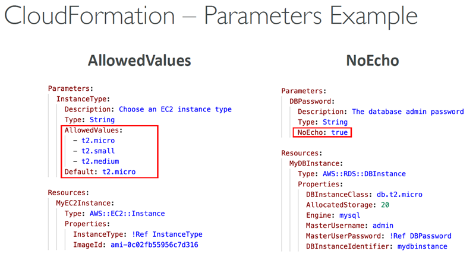

### Outputs and cross-stack references
- **Outputs** expose useful resource values such as a VPC ID or security-group ID.
- section declares `optional outputs` values that we can import into other stacks

  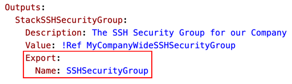

- An output can be exported and `referenced by another stack` with `Fn::ImportValue`, enabling collaboration between stacks.
- An exported value cannot be removed, nor` can its exporting stack be deleted, while another stack imports it`.
- Exports are scoped to the same account and Region.

  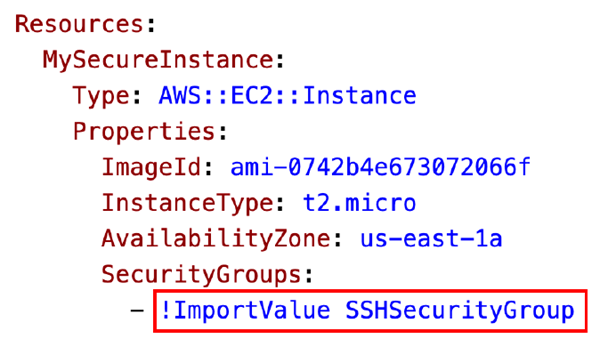

### Conditions
- Conditions are used to `control the creation` of resources or outputs based on a condition
- `Conditions`, often based on parameters or mappings
- can include or exclude` resources and outputs`.
- `Fn::If` and logical functions such as `Fn::Equals`, `Fn::And`, `Fn::Not`, and `Fn::Or` express condition logic.
- Each condition can reference another condition, parameter value or mapping

  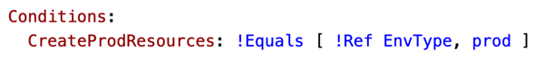
  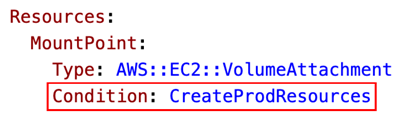

### Intrinsic Functions
| Must-know function | Usage | example |
| --- | --- | --- |
| `Ref` | References a parameter value or a resource's physical ID. | 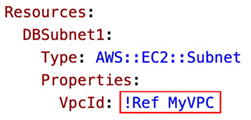 |
| `Fn::GetAtt` | Returns an attribute of a resource. | 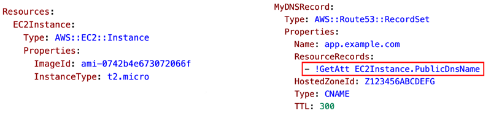 |
| `Fn::FindInMap` | Retrieves a named value from a specific key. | 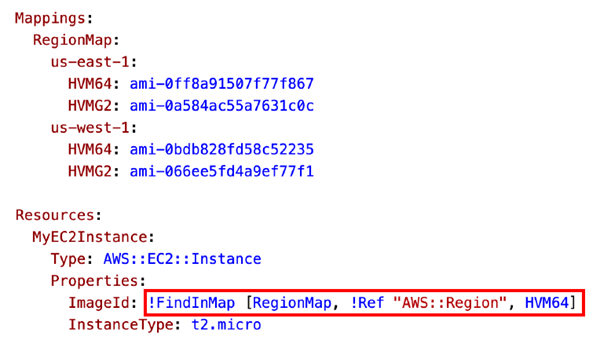 |
| `Fn::ImportValue` | Imports an exported output from another stack in the same account and Region. | 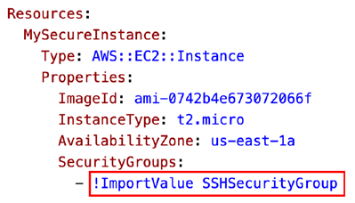 |
| `Fn::Base64` | Encodes a string as Base64, commonly for EC2 user data. | 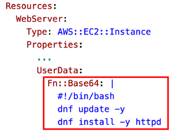 | 
  
Other functions
-------
| Function | Usage |
| --- | --- |
| Condition functions (`Fn::If`, `Fn::Equals`, `Fn::And`, `Fn::Or`, `Fn::Not`) | Evaluate conditions and choose values or control whether resources and outputs are included. |
| `Fn::Join` | Combines a list of values into a string, inserting a delimiter between them. |
| `Fn::Sub` | Substitutes parameters, resource attributes, and supplied variables into a string. |
| `Fn::ForEach` | Repeats a template fragment for each item in a collection. |
| `Fn::ToJsonString` | Converts an object or array into a JSON-formatted string. |
| `Fn::Cidr` | Generates a list of CIDR address ranges from a base CIDR block. |
| `Fn::GetAZs` | Returns the Availability Zones for a Region. |
| `Fn::Select` | Returns the item at a specified index in a list. |
| `Fn::Split` | Splits a delimited string into a list of values. |
| `Fn::Transform` | Invokes a macro to process and transform part of a template. |
| `Fn::Length` | Returns the number of items in a list. |

  

### Intrinsic and pseudo parameters
- The `Fn::Ref` function 
  - can be leveraged to reference parameters
  - The function can also reference other elements within the template
  - To retrieve:
    - `Parameters` – returns the value of the parameter
    - `Resources` – returns the physical ID of the underlying resource (e.g., EC2 ID)
- `!Ref` (in yaml) returns a parameter's supplied value or a resource's physical identifier.
- `Fn::GetAtt` reads a resource attribute defined by that resource type, such as an instance's public DNS name.
- Other useful functions include `Fn::Sub` for string substitution, `Fn::Join`, `Fn::Select`, `Fn::GetAZs`, `Fn::Base64`, and condition functions.
- YAML provides shorthand such as `!Ref`.
- Pseudo parameters are available without declaring them, including `AWS::AccountId`, `AWS::Region`, `AWS::StackName`, `AWS::StackId`, `AWS::NotificationARNs`, and `AWS::NoValue`.

## Safe stack changes and permissions
### Preview and recover from changes
- A change set previews the resource changes CloudFormation expects from an update, helping catch replacement or deletion of important resources before execution.
- Review the change set, especially for stateful resources, before applying it.
- Review stack events to locate the failure.

### Rollbacks
- Stack `Creation Fails`:
  - **Default**: everything rolls back (gets deleted). We can look at the log
  - Option to disable rollback and troubleshoot what happened
- Stack `Update Fails`:
  - The stack automatically `rolls back to the previous known` working state
  - Ability to see in the log what happened and error messages
- `Rollback Failure`
  - If rollback itself fails, correct the underlying issue and continue the rollback with the console or `ContinueUpdateRollback`.
  - Or from the CLI using continue-update-rollback API call

### Service Roles and capability acknowledgements
#### Service Role
- A `service role` lets CloudFormation create, update, or delete stack resources using the role's permissions, rather than requiring every caller to have direct permissions for each resource.
- `Give ability to users` to `create/update/delete the stack` resources `even if they don’t have permissions` to work with the resources in the stack
- Use cases:
  - You want to achieve the least privilege principle
  - But you don’t want to give the user all the required permissions to create the stack resources
- A user who supplies the role needs `iam:PassRole`; keep both the role and the ability to pass it least-privileged.
    
    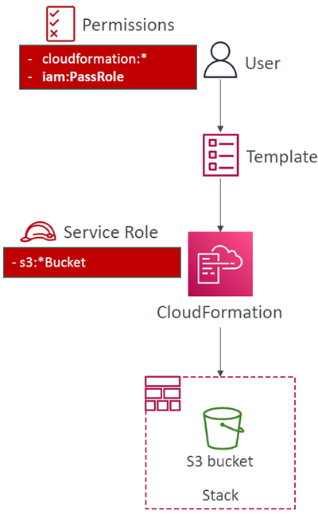

#### Capabilities
- A template that `creates or updates IAM resources` requires acknowledging `CAPABILITY_IAM` or `CAPABILITY_NAMED_IAM` (the latter when named IAM resources are specified/named).
- Templates using `macros or nested stacks` may require `CAPABILITY_AUTO_EXPAND`.
- Missing acknowledgements produce an insufficient-capabilities error `InsufficientCapabilitiesException`; they are an explicit security confirmation, not a grant of IAM permissions.

### Deletion and update protections
#### DeletionPolicy Delete
- `DeletionPolicy`: Control what happens when the CloudFormation template is deleted or when a resource is removed from a CloudFormation template
- Options:
  - `delete`
    - `Default DeletionPolicy=Delete` - The default deletion behavior is to delete a resource when the stack is deleted or the resource is removed from the template.
    - An `S3 bucket cannot be deleted while it contains objects` unless those objects are first removed.
  - `retain`
    - `DeletionPolicy: Retain` preserves a resource outside stack management.
  - `snapshot`
    - `DeletionPolicy: Snapshot` takes a final snapshot `before deletion` for supported resources such as RDS databases and EBS volumes, ElastiCache Cluster, ElastiCache ReplicationGroup, Redshift Cluster, Neptune DBCluster, DocumentDB DBCluster
    
#### Stack Policies
- Stack policies `constrain` which resources can be updated `during stack updates`.
- Once a policy is set, resources are protected by default unless the policy explicitly permits the update; use this to guard a production database against an unintended replacement.
- If `no stack policy` is set, stack-policy checks `allow updates` to all resources by default. Once a `stack policy is set`, `updates are denied` by default unless explicitly allowed.
- A `Stack Policy is a JSON document` that defines the update actions that are allowed on specific resources during Stack updates
- Protect resources from unintentional updates
- When you set a Stack Policy, `all resources in the Stack are protected by default`
- Specify an explicit ALLOW for the resources you want to be allowed to be updated
- Use `TerminationProtection` - prevents accidental deletion of a stack.
- A stack policy is separate from IAM permissions and termination protection.

  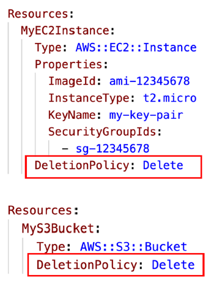

## Custom resources and StackSets
### Custom resources
- Used to:
  - define resources not yet supported by CloudFormation
  - define custom provisioning logic for resources can that be outside of CloudFormation (on-premises resources, 3rd party resources…)
  - have custom scripts run during create / update / delete through Lambda functions (running a Lambda function to empty an S3 bucket before being deleted)
- A custom resource runs provisioning logic during stack create, update, or delete for a resource type or action `CloudFormation does not natively support`.
- It is declared as `AWS::CloudFormation::CustomResource` or `Custom::...` and backed most commonly by a Lambda function (or an SNS topic).
- `ServiceToken` specifies `where CloudFormation sends requests to`, such as Lambda ARN or SNS ARN (required & must be in the `same region`)
- For example, custom logic can empty a non-empty S3 bucket before CloudFormation deletes it.

### StackSets
- StackSets `apply a template across multiple AWS accounts and Regions` from `one operation`.
- A StackSet contains stack instances in the targeted account/Region pairs; updating it can update all associated instances.
- In an AWS Organization, centralized deployment can target member accounts, and the administrator or delegated administrator manages StackSets.
- Target accounts to create, update, delete stack instances from StackSets
- `When you update a stack set, all associated stack instances are updated` throughout all accounts and regions
- `Can be applied into all accounts of an AWS Organization`
- Only Administrator account (or Delegated Administrator) can create StackSets

  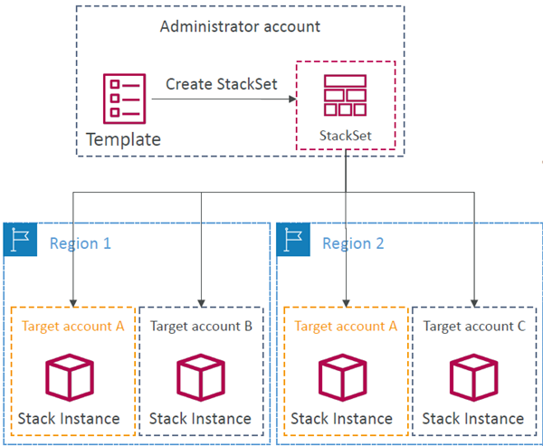