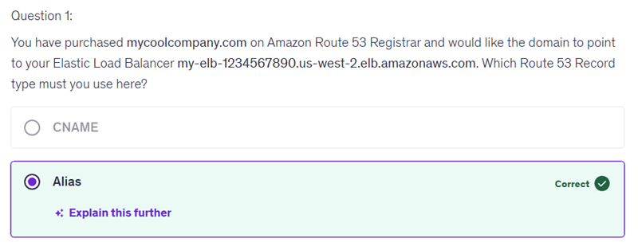
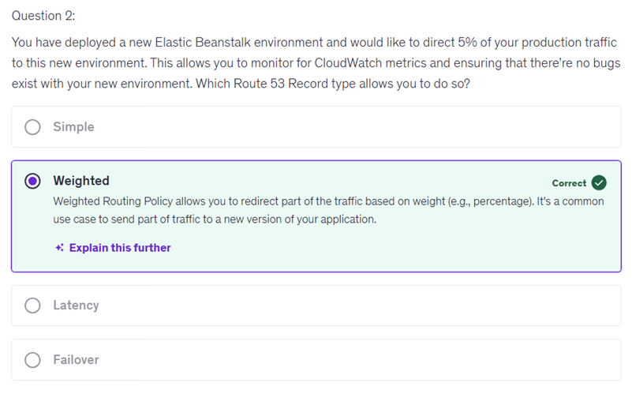
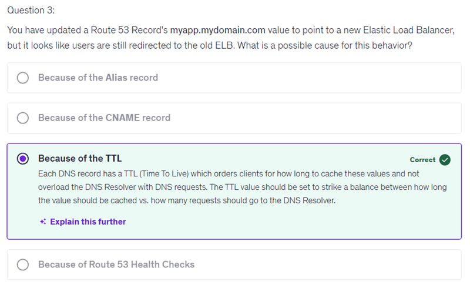
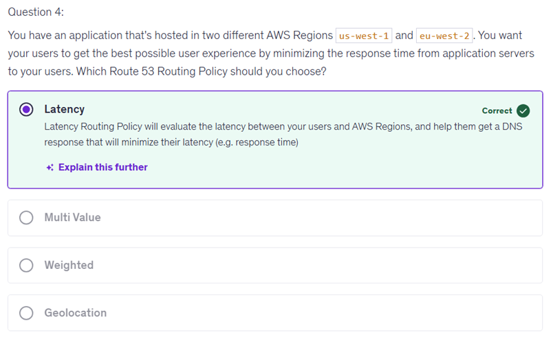
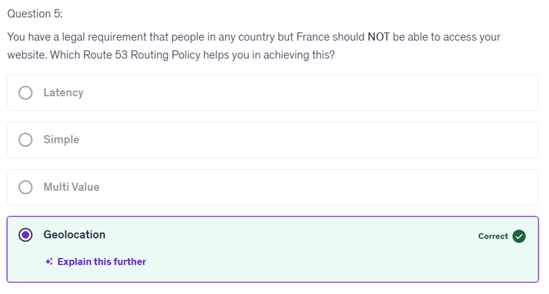
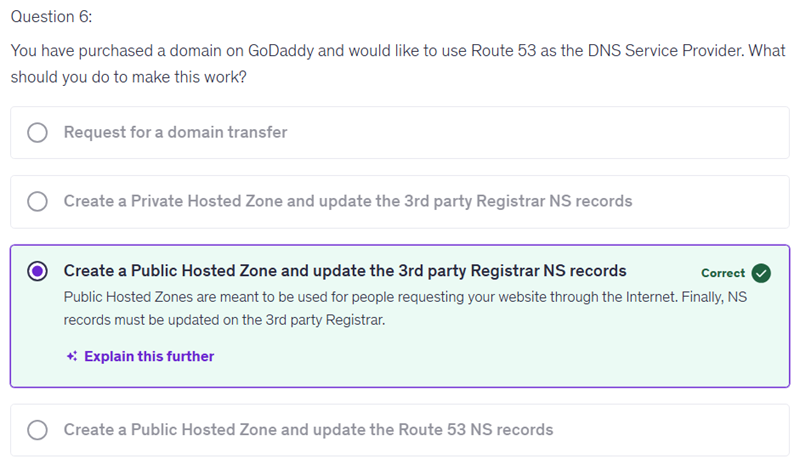
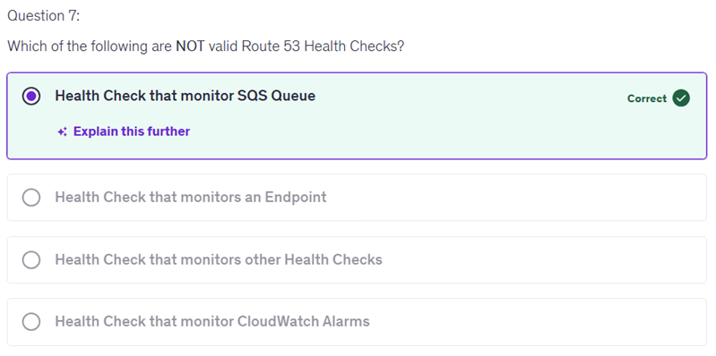

# Amazon Route 53

You selected "Alias" because, unlike CNAME records, Alias records can be used at the root domain level (Zone Apex) to point directly to AWS resources like Elastic Load Balancers.

"Geolocation" is incorrect because this routing policy directs traffic based on the geographic location of your users, rather than focusing on minimizing response times. While geolocation can help serve users from regions closest to them, it doesn't specifically account for the performance or latency of the connection to the servers. In scenarios where multiple regions are involved, prioritizing latency ensures users receive the best possible response time based on network performance, which is crucial for enhancing user experience. 

Your selection of "Create a Public Hosted Zone and update the Route 53 NS records" is incorrect because the name servers (NS) that you need to update must be done at the registrar where you purchased the domain, in this case, GoDaddy. By updating the Route 53 NS records, you won't actually change the DNS settings that are required for your domain to resolve correctly on the internet. It's important to ensure that the NS records are set properly at your domain registrar for the DNS service to function correctly. 

Private Hosted Zones are designed for internal use within a Virtual Private Cloud (VPC) and are not accessible over the public internet.

