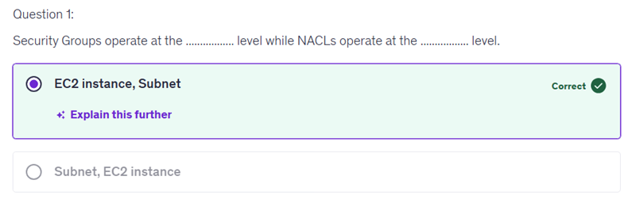
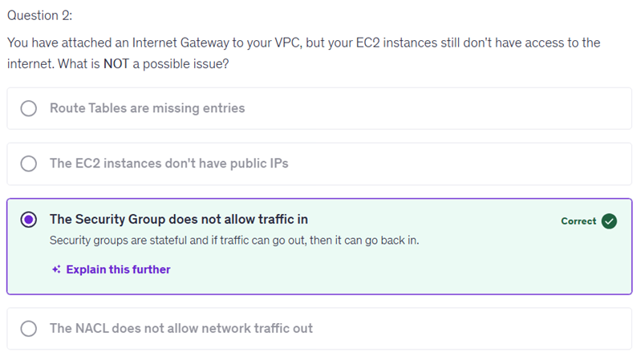
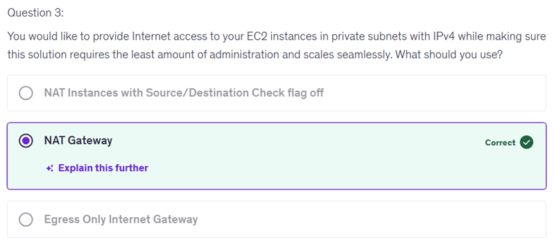
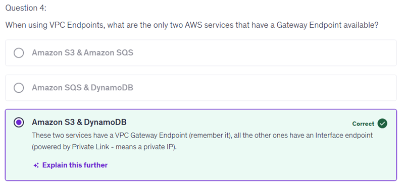
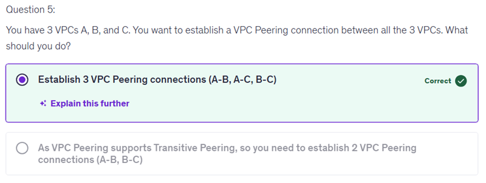
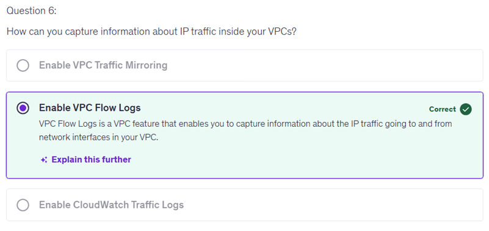
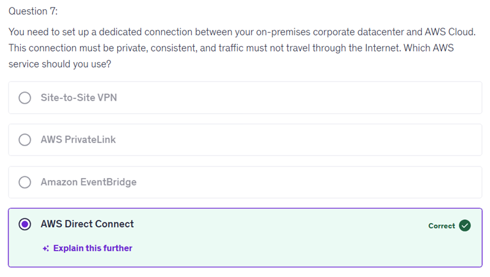
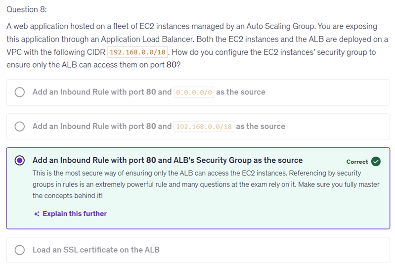

# 10 - Amazon VPC Basics

Selecting "The EC2 instances don't have public IPs" as the answer is incorrect because, while not having public IPs would indeed prevent instances from directly accessing the internet, this is not necessarily a factor when determining the cause of the connectivity issue in the context of the question.
In scenarios where an Internet Gateway is attached to the VPC, EC2 instances can still communicate with the internet if properly configured, regardless of whether they possess public IPs. For example, having a private subnet with a configured NAT gateway can allow instances without public IPs to access the internet for updates, etc.

Selecting "Route Tables are missing entries" is incorrect because having route table entries alone does not guarantee internet connectivity for your EC2 instances. Even if route tables are properly configured, instances require additional configurations to access the internet, such as having a public IP or being located in a subnet that routes traffic through an Internet Gateway or NAT Gateway.
It's essential to consider the broader context of your AWS network setup when troubleshooting connectivity issues. Focusing solely on route tables may overlook other critical factors that affect access to the internet.

Selecting "Add an Inbound Rule with port 80 and 192.168.0.0/18 as the source" is incorrect because this configuration allows any incoming traffic from the entire CIDR block of 192.168.0.0/18 to access your EC2 instances on port 80. This means that not only the Application Load Balancer (ALB) but any resource within that IP range could communicate with your instances, which poses a security risk.
The goal is to ensure that only the ALB can reach the EC2 instances on this port. By specifying a more precise source, you can better control access, enhancing the security of your web application