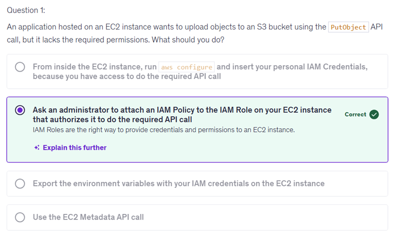
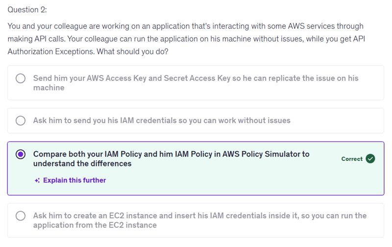
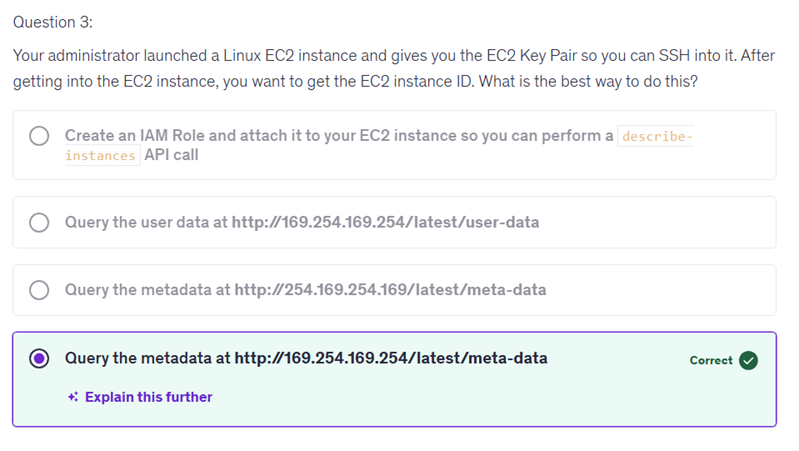
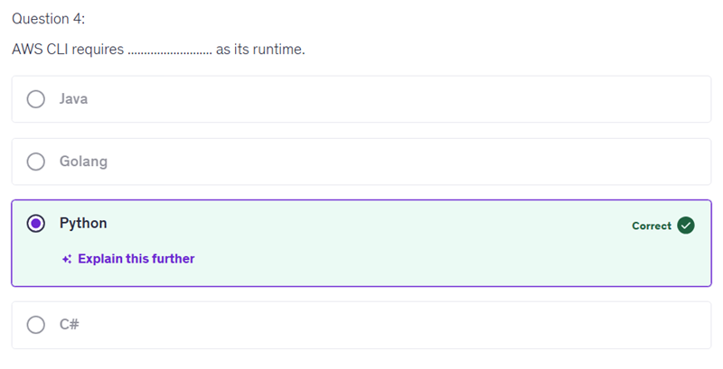
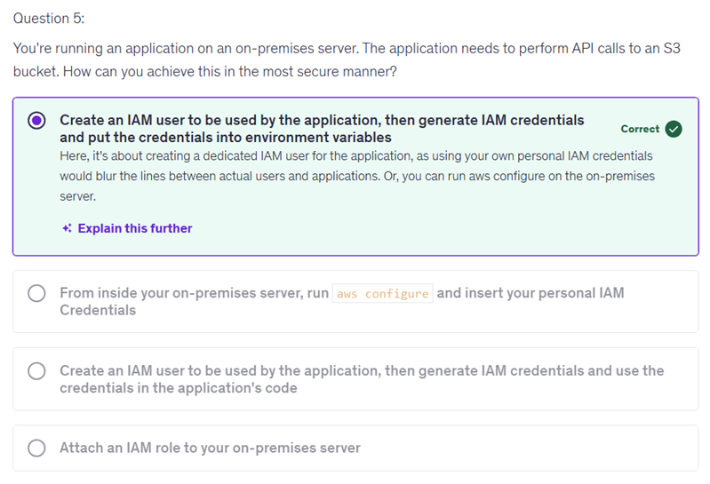
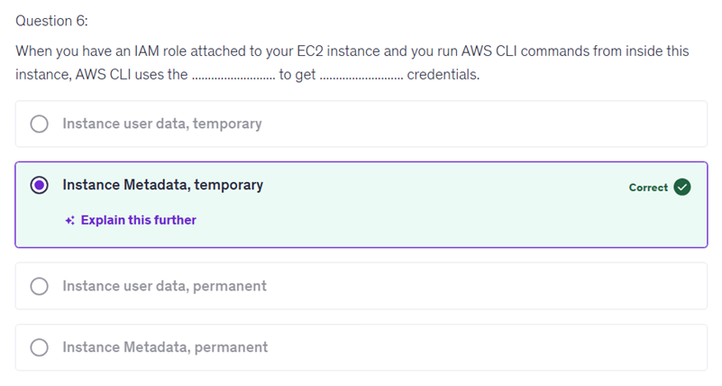
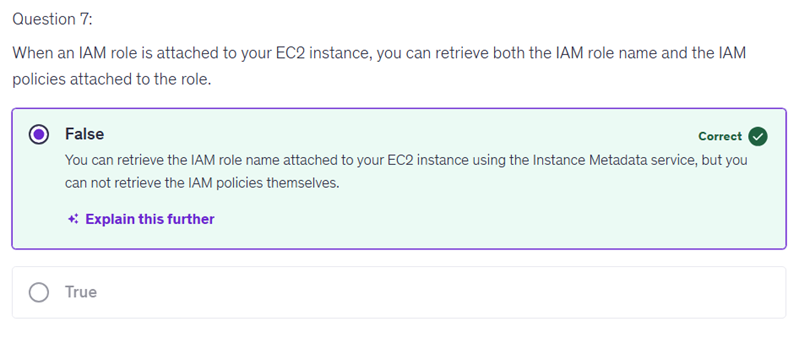
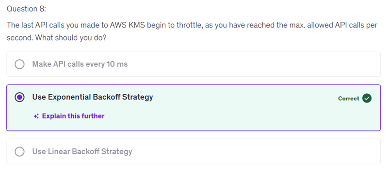
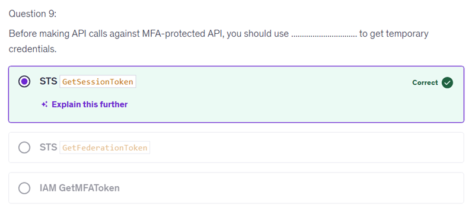
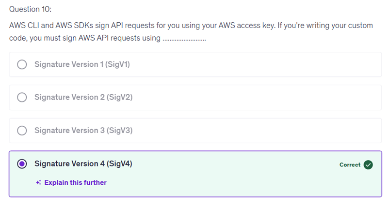

# 12 - AWS CLI SDK IAM Roles and Policies

Putting IAM credentials directly into your application's code is not secure because it increases the risk of those credentials being exposed, especially if the code is shared, deployed, or accessed by unauthorized individuals. Instead, it's best practice to keep sensitive information like credentials outside of your codebase, using environment variables or other secure storage solutions to manage them. This approach helps to maintain security and control over access to AWS resources, aligning with industry standards for secure application development.

