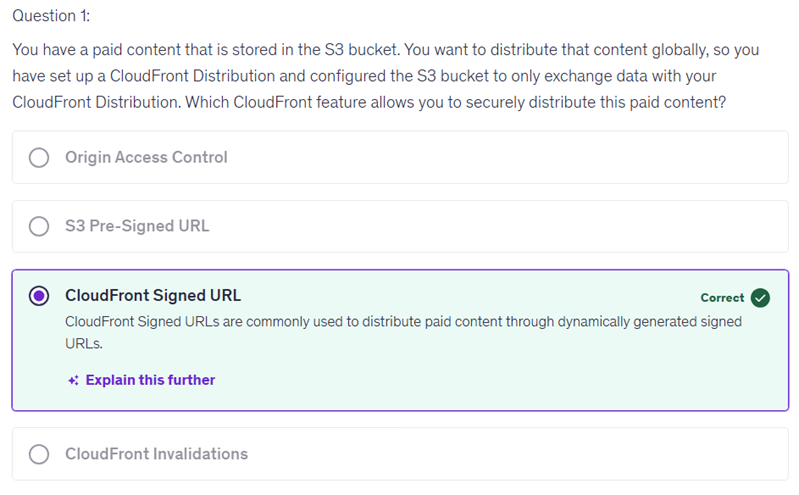
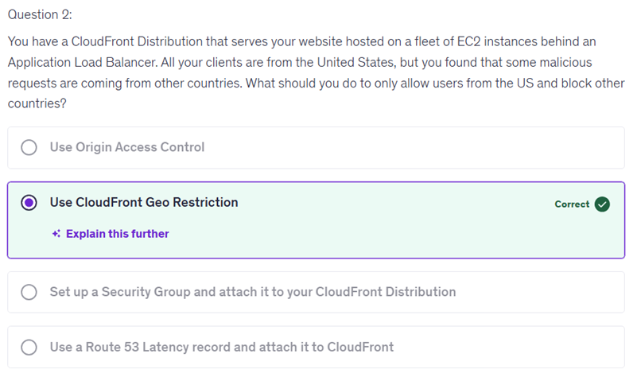
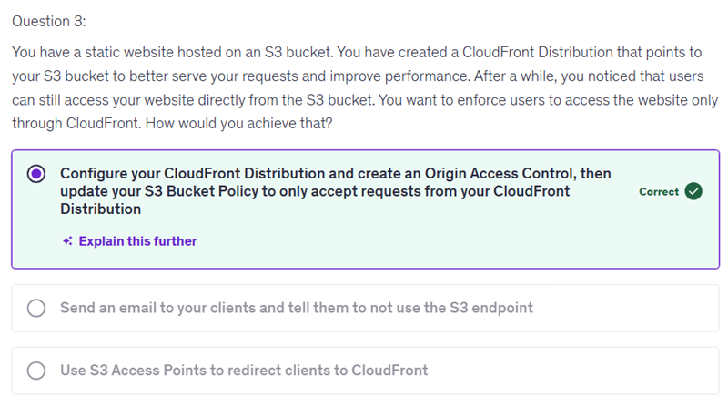
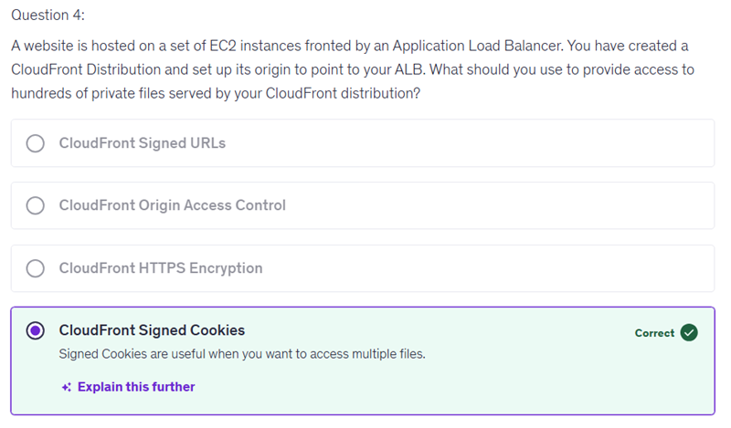
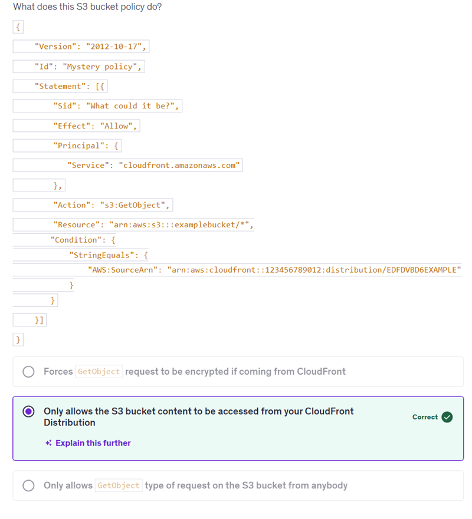
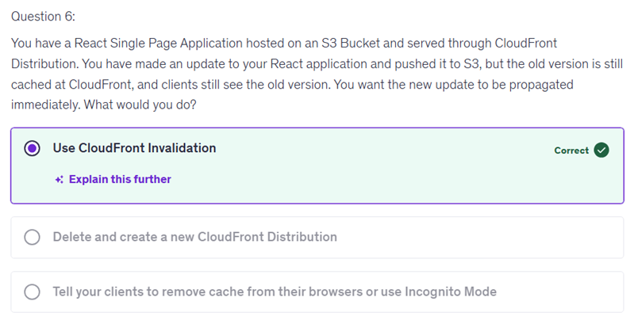
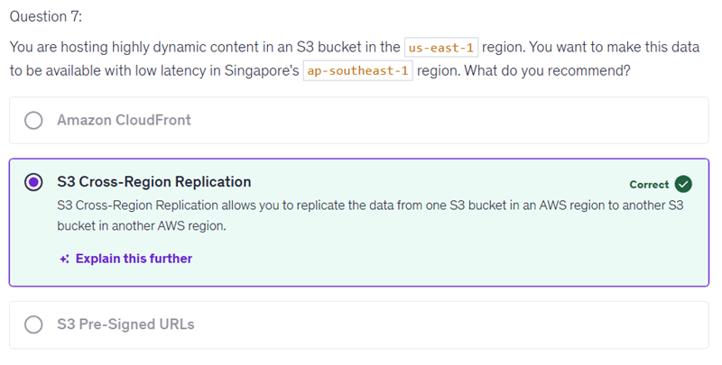
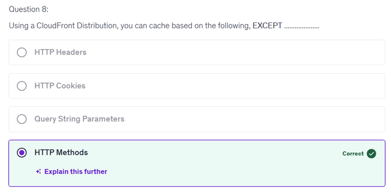
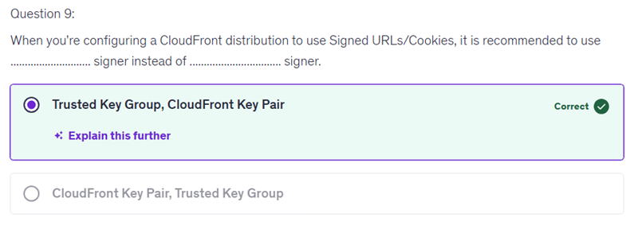

# 15 - Amazon CloudFront

- The choice of 'Origin Access Control' is incorrect because it typically pertains to controlling access to your origin resources in a web configuration context, rather than addressing the specific concept the question is focusing on. This can lead to confusion, as learners might assume it covers a broader scope of access management than intended.
- The reason the answer choice 'S3 Pre-Signed URL' is incorrect is that it specifically pertains to providing time-limited access to S3 objects, rather than directly addressing the broader access control mechanisms that are relevant to the quiz question. Many learners might confuse the functionality of pre-signed URLs with overall access management, leading to this selection. It's important to distinguish between specific access methods like pre-signed URLs and general access control strategies to deepen your understanding of how each fits into data management and security frameworks.

Let's break down why CloudFront is not the best choice for this scenario step-by-step:

Understanding the scenario:
You have highly dynamic content stored in an S3 bucket in the us-east-1 region and want to serve it with low latency specifically in the ap-southeast-1 region (Singapore).

How CloudFront works:
CloudFront is a Content Delivery Network (CDN) that caches static content at edge locations worldwide to reduce latency for end users accessing that content.

It provides a cache layer but does not replicate or sync your original data across regions.
For dynamic content that changes frequently, CloudFront’s cache might serve outdated content unless caching is properly managed, which can be complex and cause latency when fetching fresh content.
What the question focuses on:
The question states the content is highly dynamic, meaning it changes frequently and requires fresh data to be served with guaranteed low latency in Singapore.

Why CloudFront is suboptimal here:

While CloudFront can reduce latency, it still retrieves data from the origin (us-east-1 S3 bucket) for dynamic content if the cache is expired or bypassed, which adds latency especially across continents.
Caching dynamic content effectively with CloudFront requires very short TTLs (time-to-live), which reduces cache hit ratio and worsens performance.
CloudFront doesn’t provide direct data replication or local copies in the ap-southeast-1 region.
Why S3 Cross-Region Replication is better:

With Cross-Region Replication, your data is physically copied to a bucket in the ap-southeast-1 region.
Applications accessing data in Singapore can directly read from the local bucket, ensuring truly low latency with fresh data.
This approach better meets the requirement for dynamic content availability with low latency in the target region.
In summary: CloudFront is ideal for mostly static content globally distributed, but for highly dynamic content requiring low latency access in a different region, replicating the data using S3 Cross-Region Replication is the more appropriate solution.

Let's break down the correct answer: "Trusted Key Group, CloudFront Key Pair" step-by-step:

CloudFront Signed URLs and Signed Cookies
These are used to restrict access to your content in CloudFront, allowing only authorized users to access your files.

CloudFront Key Pair (Legacy approach)

Historically, CloudFront required you to create a CloudFront key pair associated with your AWS account's root user to sign URLs or cookies.
This approach poses several problems:
Security risk of using root user credentials.
Key pair management is manual and cumbersome.
Less flexible with permissions.
Trusted Key Group (Recommended approach)

A Trusted Key Group is a newer security construct that allows you to create a group of public keys in AWS IAM that can be assigned permissions for signing CloudFront URLs/cookies.
The associated private keys are used to generate signatures, but these keys are managed securely and separately from the root AWS keys.
This approach improves security best practices by avoiding root key usage and allows better key management and rotation.
Why "Trusted Key Group" instead of "CloudFront Key Pair"?

AWS recommends using Trusted Key Groups because they are more secure and easier to manage.
Using CloudFront Key Pair is considered deprecated and less secure because of its ties to root account access and harder manual management.
In summary:

Use a Trusted Key Group as the signer because it offers better security and management capabilities.
Avoid using CloudFront Key Pair for signing, as it is an older, less secure method tied to root user credentials.
This explains why the answer is "Trusted Key Group, CloudFront Key Pair" — you should configure CloudFront with the newer recommended signer (Trusted Key Group) rather than the legacy signer (CloudFront Key Pair).