# 16 - Containers on AWS

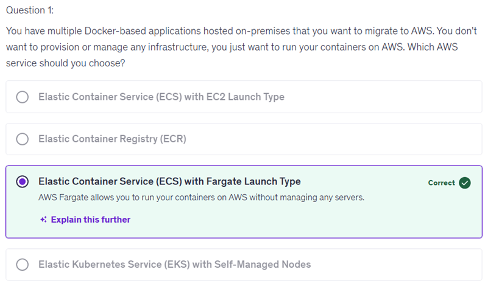

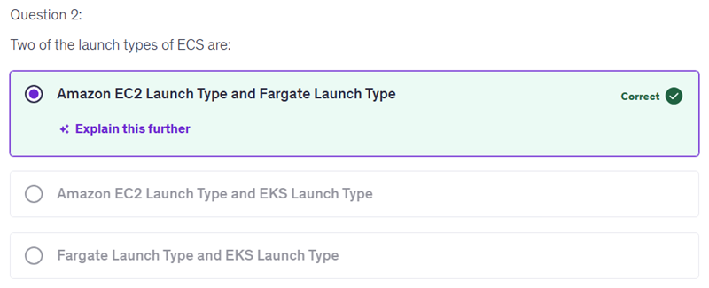

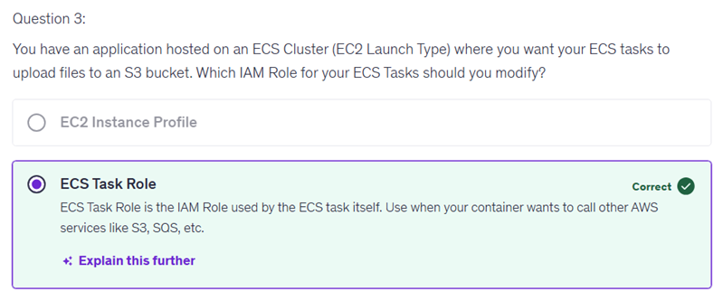
Here's a step-by-step reasoning to explain why EC2 Instance Profile is not the right answer in this context:

Purpose of EC2 Instance Profile:

The EC2 Instance Profile is an IAM Role attached to the EC2 instances on which the ECS tasks run (in EC2 launch type).
This role is primarily used by the ECS Agent running on the EC2 instance to perform actions like pulling Docker images from Amazon ECR, writing logs to CloudWatch, and communicating with the ECS control plane.
It grants permissions needed at the instance level, not the individual task/container inside the instance.
Task's Need to Access AWS Services:

Your question says the ECS Task needs to upload files to an S3 bucket.
This means the individual container or task needs permission to talk to S3 directly.
Use of ECS Task Role:

The ECS Task Role is an IAM Role assigned to individual tasks (containers) running inside the EC2 instance.
This role is assumed by the container itself, allowing it to call AWS services such as S3, SQS, DynamoDB, etc.
This is precisely the role you modify to grant permissions for uploading to S3.
Separation of responsibilities:

EC2 Instance profile handles the needs of the EC2 instance and the agent running on it.
ECS Task Role handles permissions for operations initiated inside the containers (tasks).
Summary: Because the requirement is for the ECS tasks (containers) to upload files to S3, the role you modify must be the ECS Task Role. Modifying only the EC2 Instance Profile will not grant the running container the necessary permissions to access S3.

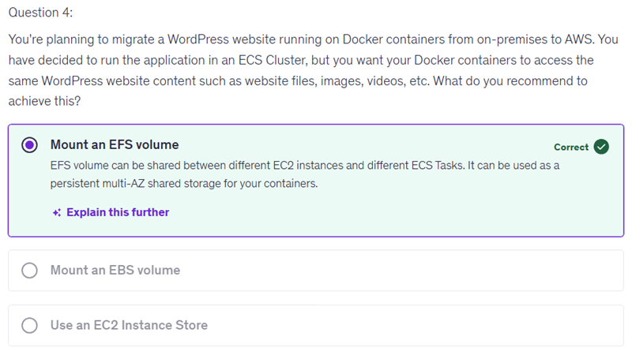
Editing the S3 bucket policy to allow the ECS task is not the right solution because S3 bucket policies control access at the resource level, which can lead to broader permissions than intended. This approach could potentially expose your S3 bucket to unauthorized access from other resources or services if they are granted permissions without proper constraints.

To effectively manage access, it's best to use IAM roles that are specifically assigned to your ECS tasks. This allows for precise control over what each task can do, ensuring that only the new application needing access to S3 can perform the actions required, while maintaining security and minimizing risks.

Focusing on IAM roles tailored for your applications aligns with best practices for managing permissions in AWS, promoting a more secure environment.

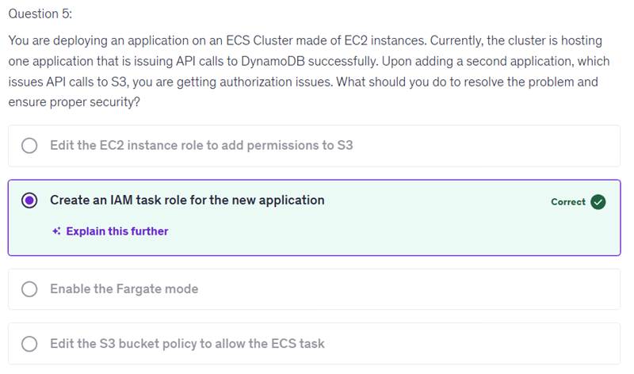

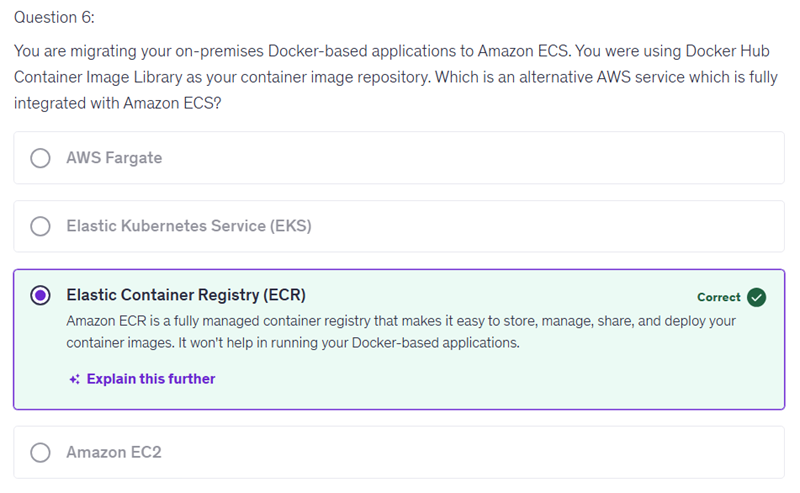

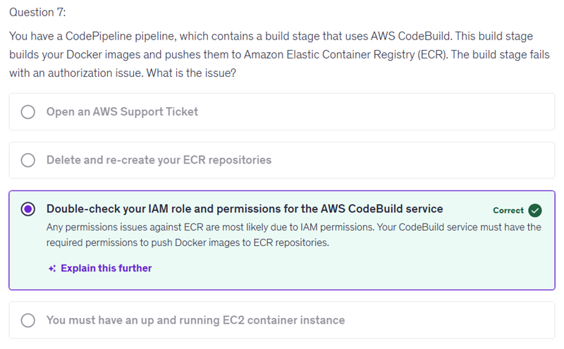

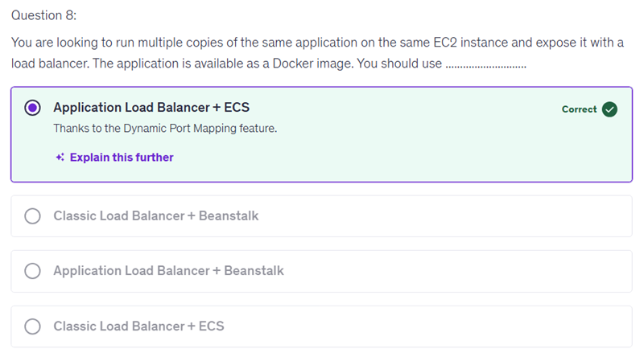
"Application Load Balancer + Beanstalk," is incorrect because Elastic Beanstalk is designed to manage applications on a higher abstraction level, and it typically requires a single port for an application. While it does support running multiple versions and can scale, it does not optimally leverage the benefits of dynamic port mapping for running multiple copies of the same application on a single EC2 instance.

In contrast, by using ECS (Elastic Container Service), you can take full advantage of features like dynamic port mapping, which allows multiple instances of the same application to run on the same instance without port conflicts. This capability aligns more closely with the scenario described in the question, where efficiency and proper load balancing among multiple application copies are key requirements.

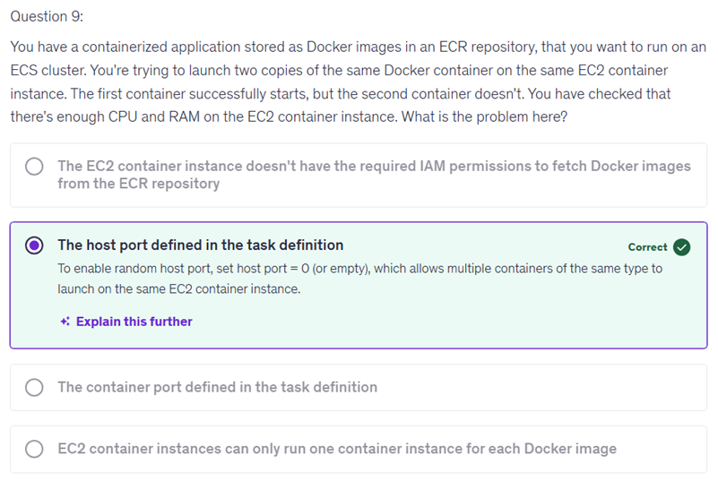
The container port is just the internal port inside the Docker container and does not affect how containers bind to the host’s network. So, it doesn’t cause conflicts when running multiple containers on the same EC2 instance. Only the host port binding can cause such conflicts.

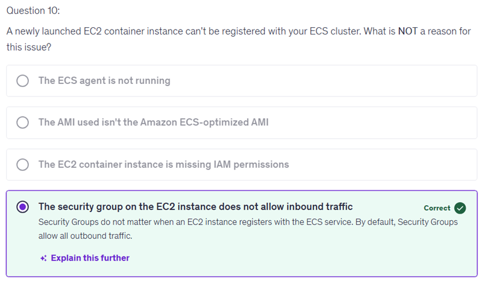
"The AMI used isn't the Amazon ECS-optimized AMI" as the reason for your EC2 container instance not registering with the ECS cluster is incorrect because the ECS agent can run on different AMIs as long as it’s correctly configured. The critical factor for registration is that the ECS agent is running, not the specific type of AMI used. This means that it's possible to use other AMIs, and registration could still proceed without issues.

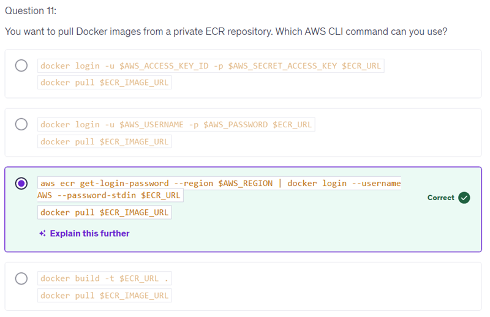

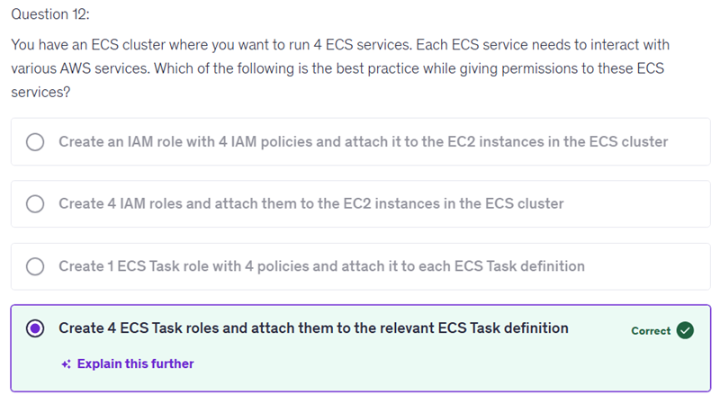

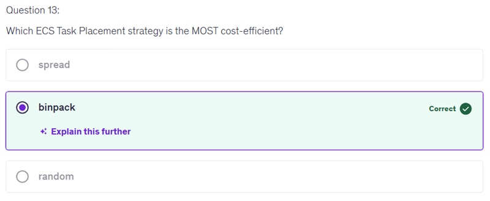

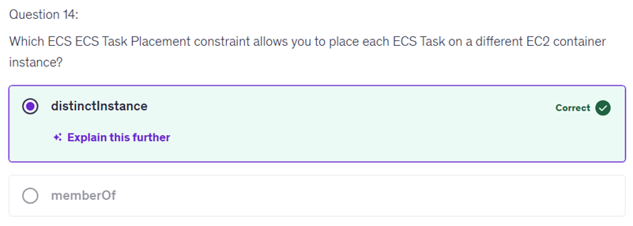

