# 17 - AWS Elastic Beanstalk

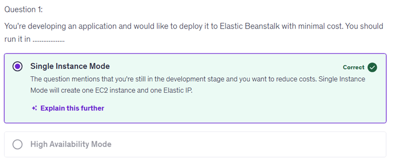

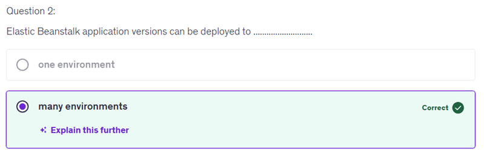

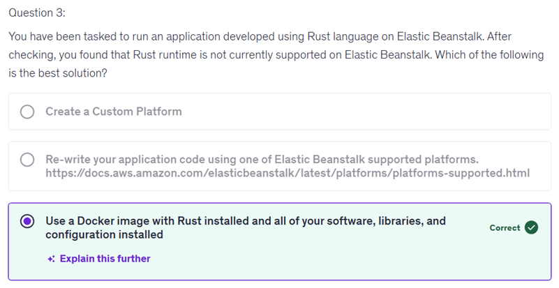

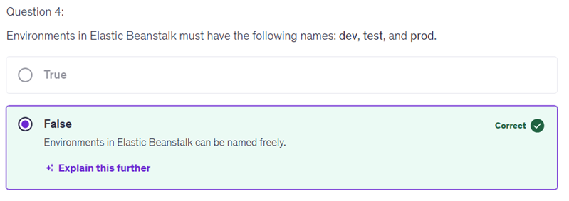

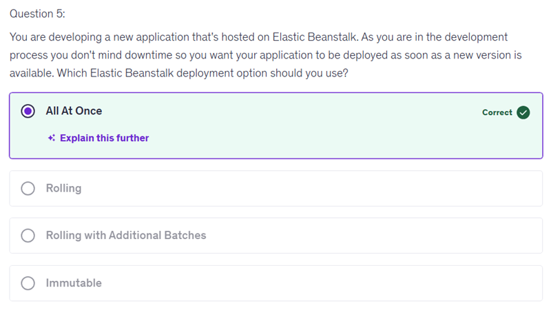

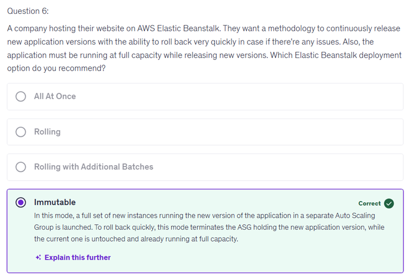

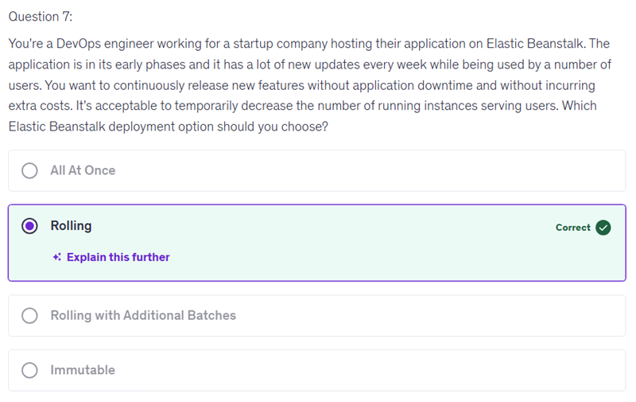

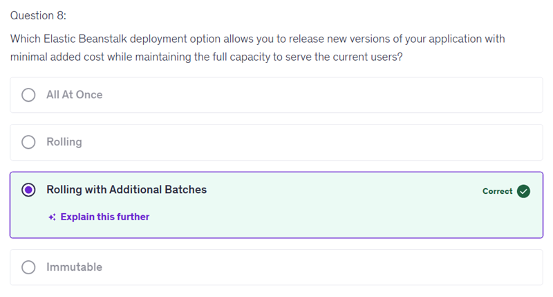

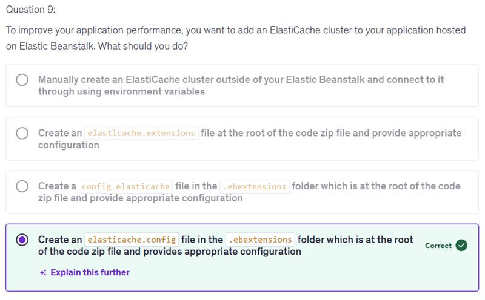
"Create a config.elasticache file in the .ebextensions folder," is incorrect because the naming convention for configuration files in the .ebextensions folder is specific. The correct format requires a specific filename—“elasticache.config” rather than “config.elasticache”. This detail is crucial because Elastic Beanstalk expects configuration files to follow a specific format to properly apply the settings during deployment. Ensuring you use the right filename is essential for your settings to be recognized and implemented correctly.

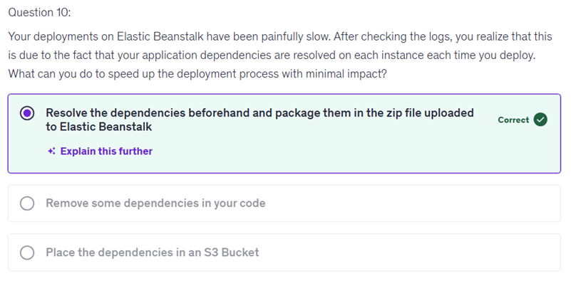

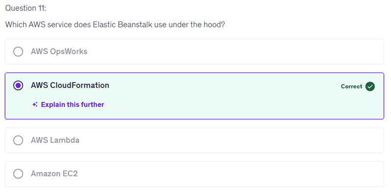

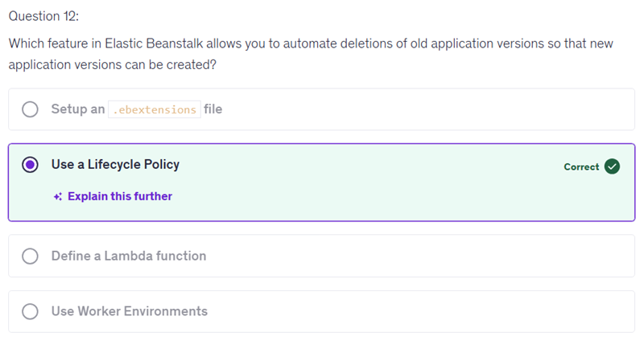

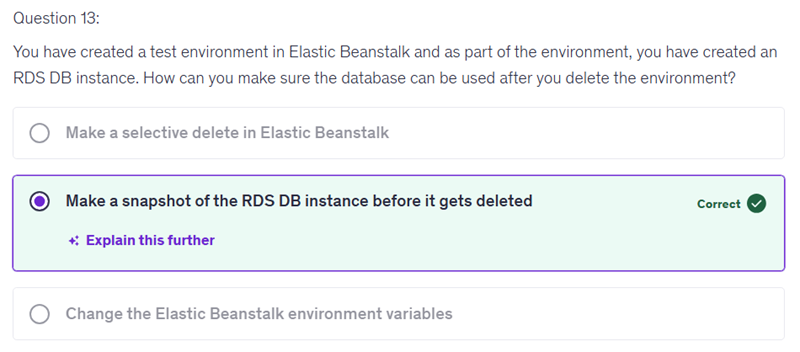

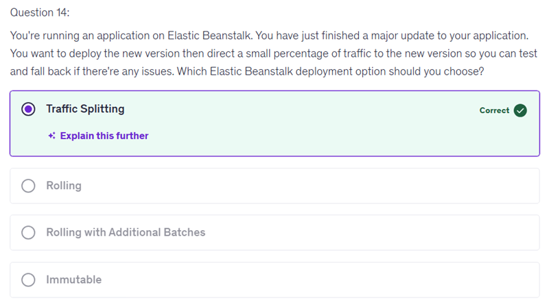

Here's the difference between Traffic Splitting (Canary) and Blue-Green Deployment broken down step-by-step with reasoning:

1. Traffic Splitting (Canary Deployment) in Elastic Beanstalk
Purpose: Gradually shift a small percentage of user traffic to a new application version to test it in production.
How it works:
You deploy the new version alongside the current one in the same Elastic Beanstalk environment.
A small portion of the incoming traffic is routed to the new version (the "canary"), while the majority continues to go to the stable version.
You monitor the canary for errors or issues.
If the new version works well, you increase traffic incrementally or switch 100% traffic to it.
If issues occur, you can quickly rollback by directing all traffic back to the original version.
Key aspect: Both versions run within the same environment, sharing the underlying resources.
2. Blue-Green Deployment
Purpose: Deploy a completely separate environment with the new application version and switch production traffic from the old version to the new version instantly.
How it works:
You create a new Elastic Beanstalk environment (the "green") with the updated application version.
The existing environment ("blue") continues serving traffic.
When you are ready, you change the environment URL or Elastic Load Balancer to route all traffic from the old environment to the new environment instantly.
If problems occur after switching, rollback is done by reverting traffic back to the original environment.
Key aspect: Two separate complete environments run independently, allowing zero downtime and easy rollback.
Summary Table:

| Feature | Traffic Splitting (Canary) | Blue-Green Deployment | 
|-----------------------------|-----------------------------------------------|-------------------------------------------------| 
| Environment structure | Single environment | Two separate environments (Blue and Green) | 
| Traffic approach | Gradually route small % of traffic to new version | Switch 100% of traffic instantly from blue to green | 
| Rollback | Redirect traffic back within same environment | Switch back to old environment | 
| Resource consumption | Lower, since same environment resources shared | Higher, requires running two full environments | 
| Downtime | Minimal, but gradual exposure to users | Typically zero downtime due to instant cutover | 
| Risk mitigation | Incremental testing on production traffic | Full environment isolation for testing |

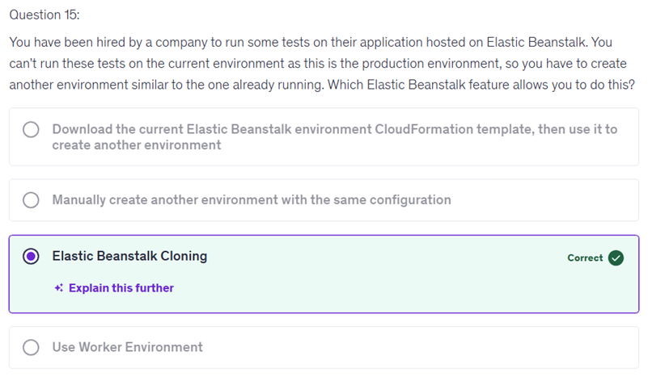
