# 18 - AWS CloudFormation

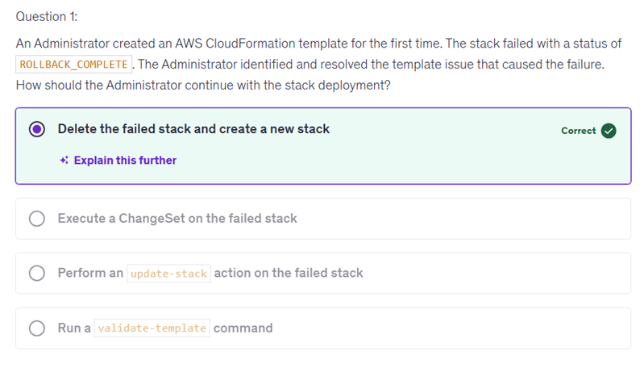
Running a validate-template command checks your CloudFormation template for syntax errors and validates its structure, but it does not address the status of the failed stack itself. When a stack fails with a status of ROLLBACK_COMPLETE, it is effectively in a terminal state and cannot be updated or changed directly. Instead, you need to remove the failed stack entirely before proceeding to create a new one with the corrected template. 
Executing a ChangeSet on a failed stack is incorrect because a stack that has reached the ROLLBACK_COMPLETE status is in a state where no further changes can be made to it. ChangeSets are intended for proposing updates or changes to an existing stack, but since your stack is effectively terminated, you cannot apply any modifications or execute a ChangeSet on it. Instead, you need to start fresh by removing the failed stack and creating a new one with the corrected template. 

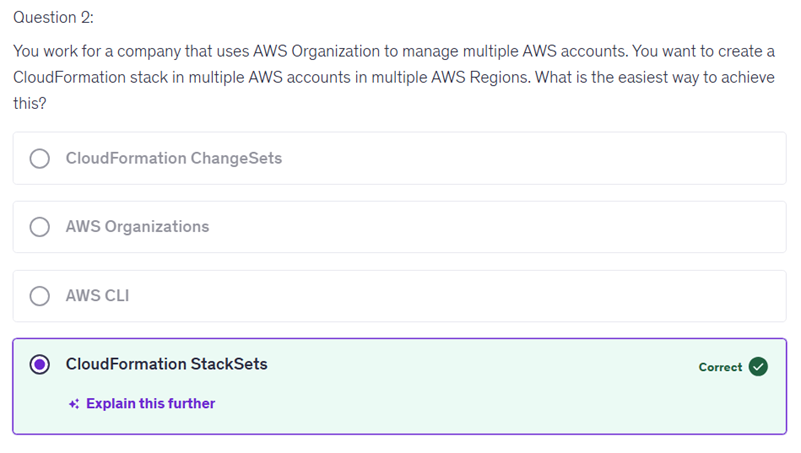
Choosing "AWS Organizations" is incorrect because while it helps manage multiple AWS accounts, it does not provide a mechanism for deploying CloudFormation stacks across those accounts and regions. AWS Organizations primarily focuses on account management and governance rather than facilitating stack creation or deployment. Instead, you would need a solution that can handle the deployment of CloudFormation templates across multiple accounts and regions efficiently. 
Choosing "CloudFormation ChangeSets" is not the right approach because ChangeSets are primarily used to preview changes before applying them to an existing stack. They don't facilitate the creation or deployment of stacks across multiple accounts and regions. In your scenario, where you want to create stacks in various accounts and regions, a more effective method would be necessary.
"CloudFormation StackSets" is correct because StackSets allows you to create, update, or delete CloudFormation stacks across multiple AWS accounts and regions simultaneously, streamlining the process of managing resources at scale.

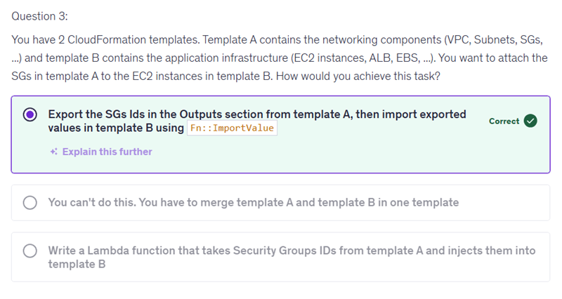
 "Export the SGs Ids in the Outputs section from template A, then import exported values in template B using Fn::ImportValue" is correct because it effectively allows you to share outputs between templates, facilitating the attachment of security groups from the networking infrastructure to the application infrastructure without the need for merging the templates. This approach reinforces your understanding of how to manage dependencies in CloudFormation efficiently.

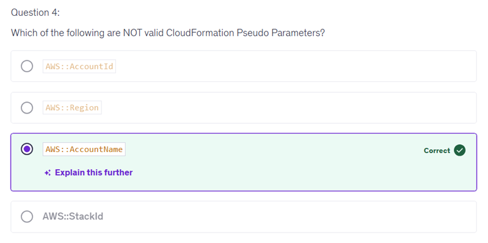
Choosing "AWS::StackId" as an invalid pseudo parameter is a misunderstanding. "AWS::StackId" is indeed a valid pseudo parameter in CloudFormation, which provides the unique identifier for the stack being created or updated.
In the context of the quiz question, it's important to remember that pseudo parameters are predefined variables that help you reference certain aspects of your CloudFormation stack. Familiarizing yourself with the valid pseudo parameters—like "AWS::AccountId" and "AWS::Region"—is crucial as they help you customize templates effectively depending on the environment in which they are deployed.

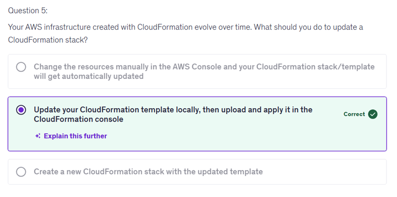
Creating a new CloudFormation stack with the updated template is not the correct approach for updating an existing stack. Instead, CloudFormation is designed to manage resources smoothly by allowing you to directly update the stack using the existing template rather than starting from scratch.
When you create a new stack, existing resources remain unchanged, and this can lead to unnecessary duplication and management complexity. Instead, you can modify your template locally, upload the changes, and CloudFormation will handle the update process, minimizing disruption and maintaining resource integrity. This method aligns better with best practices for efficient infrastructure management.

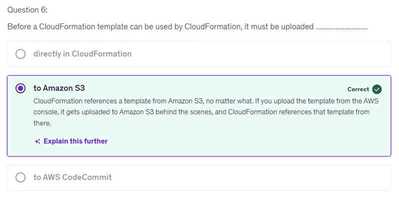
Selecting "directly in CloudFormation" is a common misunderstanding. Although you can initiate the update of a stack from the AWS CloudFormation Console, what actually happens is that your template is uploaded to Amazon S3 behind the scenes. CloudFormation references the template from this S3 location when deploying or updating stacks.

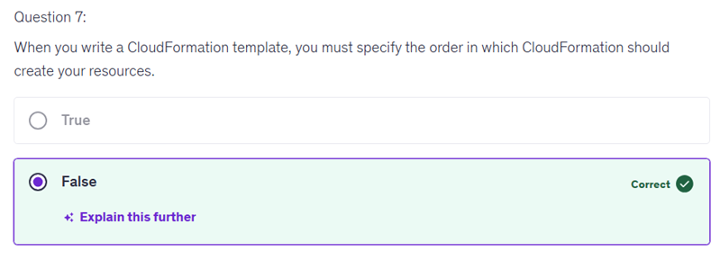

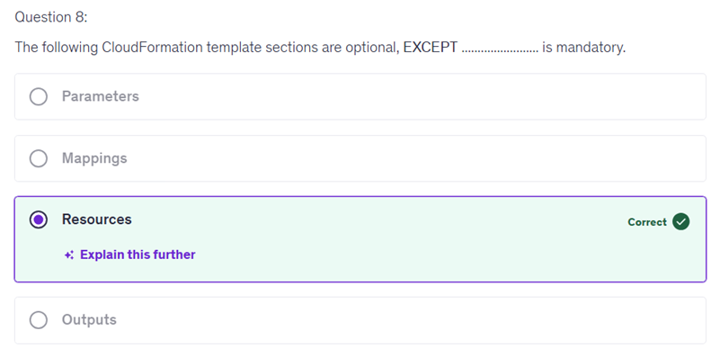

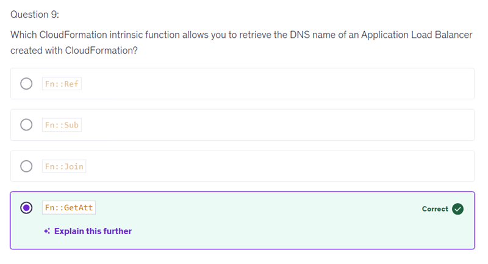
Choosing "Fn::Ref" indicates a common misconception about how to retrieve specific attributes of resources in CloudFormation. While "Fn::Ref" is indeed used to reference resources and parameters, it does not provide direct access to resource attributes like the DNS name of an Application Load Balancer.
"Fn::Ref" generally retrieves the logical ID of a resource or parameter, which is useful for referencing resources but does not extend to fetching specific details such as DNS names or other attributes. When working with attributes, it's essential to use the appropriate function designed for that purpose to ensure you effectively access the information you need.

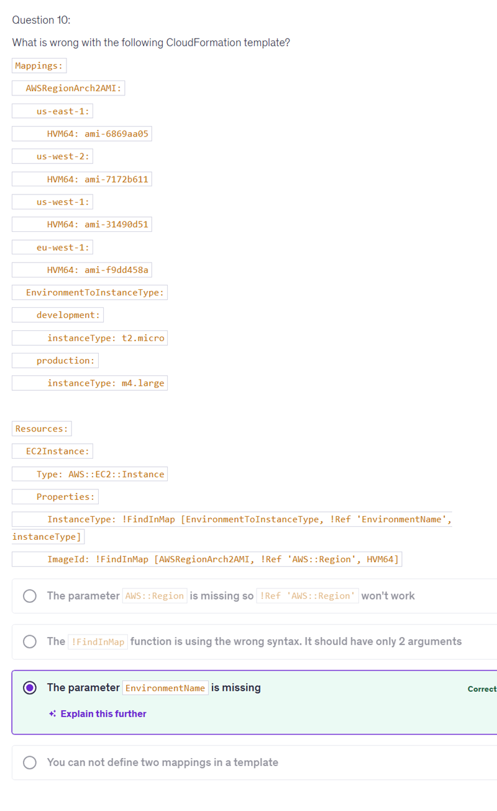
The choice you made regarding the syntax of the !FindInMap function is a common misunderstanding. The !FindInMap intrinsic function can actually take three arguments: the mapping name, the first key, and the second key. In the context of the function used in the template, the syntax you see is indeed correct as it has the required three arguments.

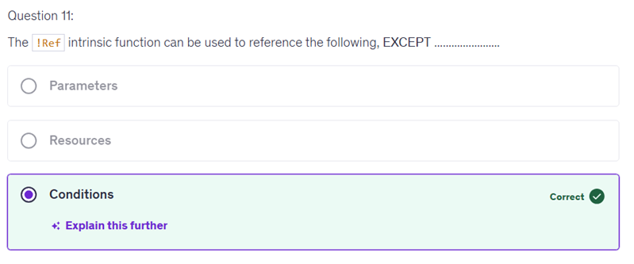

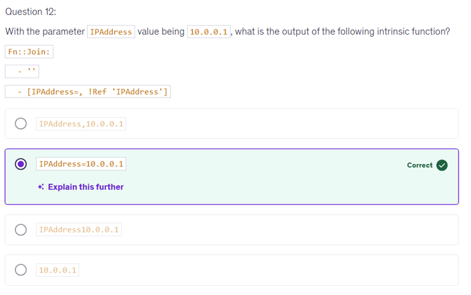
Your choice of "IPAddress,10.0.0.1" is incorrect because the syntax of the Fn::Join function in this context considers the elements being joined. The first element of the array specifies the string to use as a separator, which in this case is an empty string ''.
This means that the output will concatenate the elements in the list without any additional characters between them. Since you're referencing the parameter value directly as !Ref 'IPAddress', it will replace that with the value of the parameter IPAddress, which is 10.0.0.1.
The result of the Fn::Join function will be the string that includes the prefix "IPAddress=" followed by the actual IP address, which guides the construction of correct outputs in AWS CloudFormation templates.

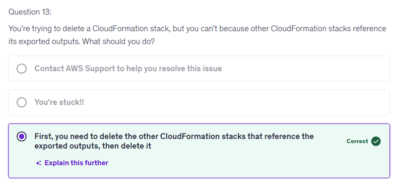

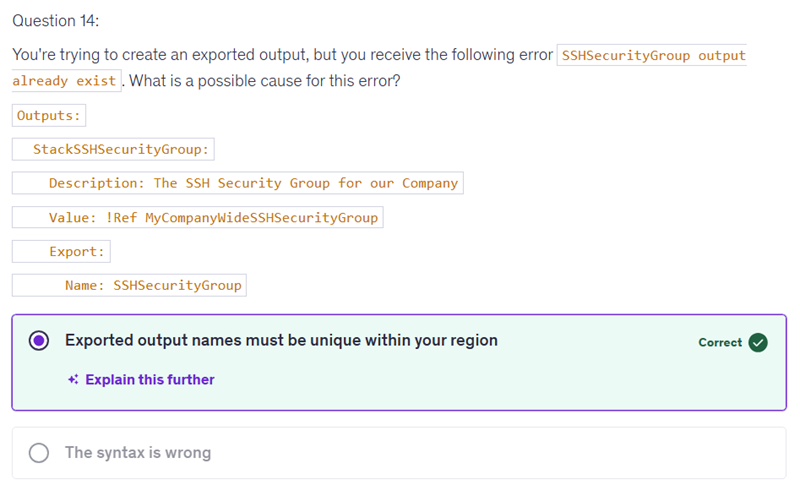

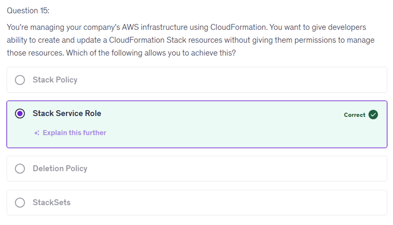
Your choice of "Stack Policy" is not the right answer because Stack Policies primarily focus on controlling updates to resources within a CloudFormation stack. They allow you to define what resources can be modified during updates but do not grant permissions to create or update the stack itself.
In the context of your question, where the goal is to allow developers to manage stack resources without giving them broader permissions, it's important to understand that the role related to stack operations is necessary. A Stack Policy does not fulfill that requirement as it does not provide the necessary permissions for the developers to interact with the stack in the way you described.

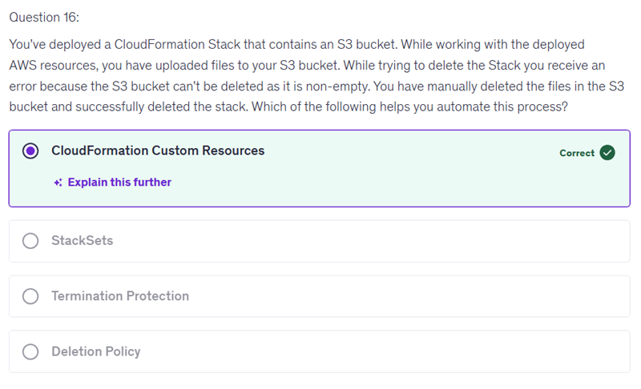
Your choice of "Deletion Policy" is incorrect because a Deletion Policy is used to specify what happens to a resource when a stack is deleted. This policy can protect certain resources from being deleted or preserve their data, but it doesn't automate the process of removing files from an S3 bucket, which is necessary before you can delete the stack.
In the scenario you presented, the issue was that the S3 bucket was not empty, causing the deletion process to fail. A Deletion Policy alone cannot handle the requirement to empty the bucket beforehand. Instead, CloudFormation Custom Resources can be used to automate tasks, such as cleaning up resources before the stack deletion occurs.

